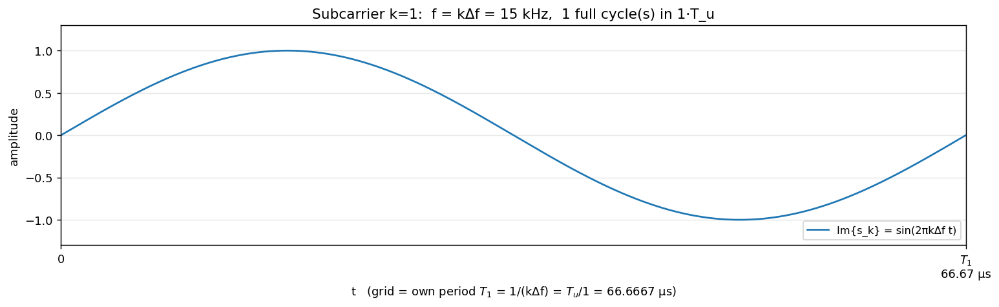
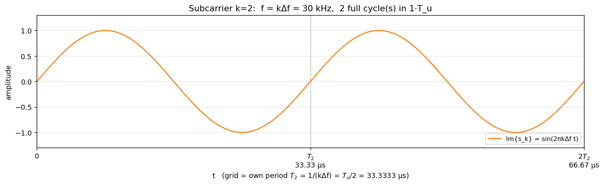
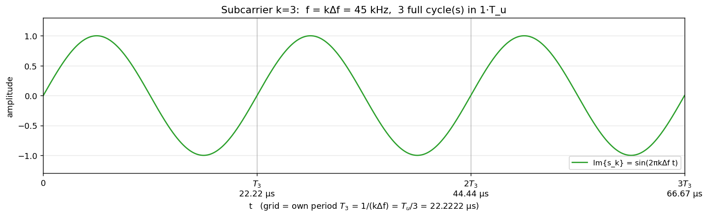
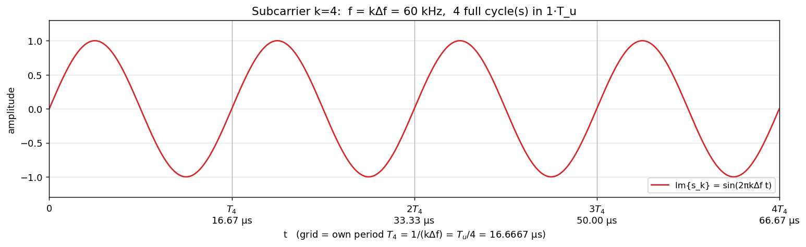
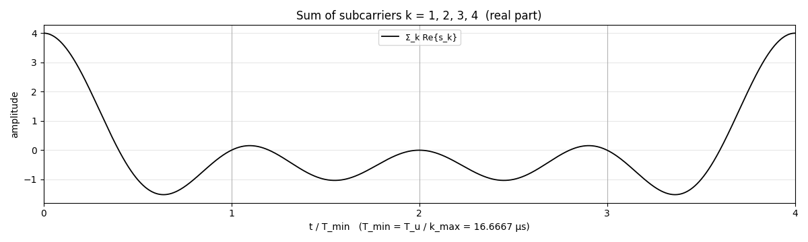
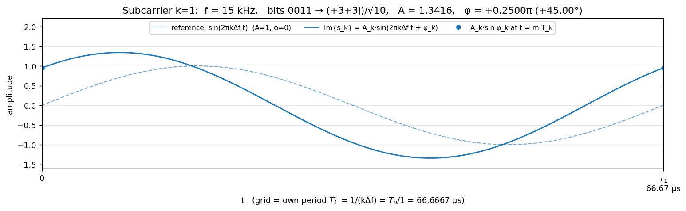
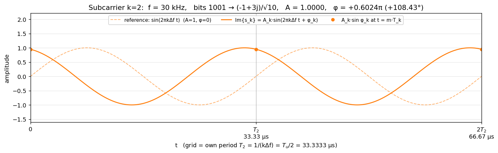
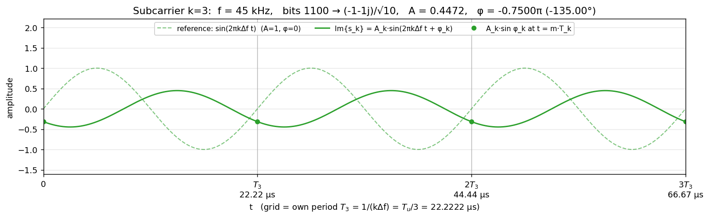
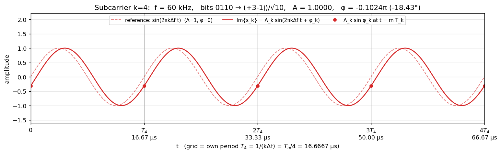
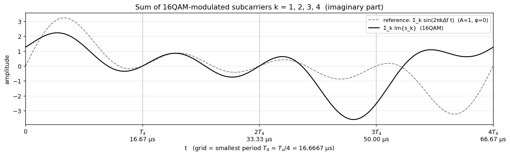

## OFDM介绍

5G NR，包括上一代的 4G LTE，都是建立在 OFDM（Orthogonal Frequency Division Multiplexing 正交频分复用）的基础上的。这里不深入介绍 OFDM，但是，我们从非常直观的角度来介绍一下 OFDM 的思想。

OFDM 的基本思想很简单，不需要用离散傅里叶变换(DFT:Discrete Fourier Transform)的知识就可以理解.  OFDM 将频带划分成**等带宽**的子载波.

例如子载波宽度是 15kHz，那么，

第一个子载波的频率是 15kHz

第二个子载波频率是 30kHz = 15kHz * 2

第三个子载波频率是 45kHz = 15kHz * 3 

第四个子载波频率是 60kHz = 15kHz * 4, 

......

这里不要把子载波的频率值与子载波的宽度混淆，各个子载波频率之间的频率间隔是 15kHz，而各个子载波的频率值是不同的，且都是第一个子载波频率的整数倍。

现在我们画图来理解一下(为了图形看起来简洁，只画出了复指数的虚部，即 sine 的部分)：

第一个子载波波形如图 1所示，这是一个完整的周期。

第二个子载波波形如图2 所示，这个时间跨度是第一个子载波的一个周期的时间。因为第二个子载波的频率是第一个子载波的2倍，所以，图中可以看到两个完整的周期。

第三个子载波波形如图3 所示，这个时间跨度是第一个子载波的一个周期的时间。因为第三个子载波的频率是第一个子载波的3倍，所以，图中可以看到三个完整的周期。

第四个子载波波形如图4 所示，这个时间跨度是第一个子载波的一个周期的时间。因为第四个子载波的频率是第一个子载波的4倍，所以，图中可以看到四个完整的周期。

*图1：First Subcarrier*

*图2：the second subcarrier*

*图3：the third subcarrier*

*图4：the fourth subcarrier*

这四个子载波的波形，在空中是同时发出的，也就是相当于这四个波形简单叠加在一起，叠加在一起后的波形如图所示5。

*图5：四个子载波叠加在一起*

我们发送波形出去，是为了携带有用的数据信息，即数据比特，所以，需要对每个子载波进行调制。前面的图示中所有的子载波的初始相位都是 0， 最大幅度都是 1，这样其实没有携带任何信息。无线通信中用不同的初始相位和/或幅度来表示携带的比特信息，例如(如果想深入理解调制，请参考 16QAM 调制):

​	各子载波的幅度/相位和对应的比特信息（$$\Delta f = 15$$\,kHz）

​	| $$k$$ | 频率 | 比特 $$b_0b_1b_2b_3$$ | 幅度 $$A_k$$ | 相位 $$\varphi_k$$ |
|---|---|---|---|---|
| 		1 | 15 kHz | 0011 | 1.3416 | $$0.25\pi$$ |
| 2 | 30 kHz | 1001 | 1.0000 | $$0.6024\pi$$ |
| 3 | 45 kHz | 1100 | 0.4472 | $$-0.75\pi$$ |
| 4 | 60 kHz | 0110 | 1.0000 | $$-0.1024\pi$$ |
| |  |  |  |  |

每个子载波携带了 4 比特的数据，用不同的初始相位和幅度来表示。现在我们再画一下携带了数据的各个子载波波形（实线），图形中的虚线是没有携带信息的 0 相位幅度为 1 的原始波形。

第一个子载波波形如图6 所示.

第二个子载波波形如图7 所示.

第三个子载波波形如图8 所示.

第四个子载波波形如图9 所示.

*图6：First Subcarrier，初始相位和幅度*

*图7：Second Subcarrier，初始相位和幅度*

*图8：Third Subcarrier，初始相位和幅度*

*图9：Fourth Subcarrier，初始相位和幅度*

携带信息的四个子载波叠加后的波形如图 10 所示。

*图10：携带信息的四个子载波叠加*

对前面的图示例子，我们用简单的数学来讨论一下，每个子载波为了携带比特信息而增加了幅度和初始相位也考虑了进去，假设 子载波带宽用 $$\Delta f$$  表示，例如是 $$\Delta f = 15 \text{kHz}$$, 对应的周期是 $$T = \frac{1}{\Delta f}$$.

第一个子载波，我们要发送的信息是 $$\beta_1 e^{j\theta_1}$$，也就是幅度信息是 $$\beta_1$$, 初始相位是 $$\theta_1$$.

第二个子载波，我们要发送的信息是 $$\beta_2 e^{j\theta_2}$$

第三个子载波，我们要发送的信息是 $$\beta_3 e^{j\theta_3}$$

第四个子载波，我们要发送的信息是 $$\beta_4 e^{j\theta_4}$$

那么，在一个周期内，即 时间参数 $$t$$  连续取遍 $$[0,T)$$ 这个时间范围:

第一个子载波的波形就是：  $$\beta_1 e^{j\theta_1} e^{j 2\pi\Delta f t}, t \in [0,T)$$，即 $$\beta_1 e^{j \left (2\pi\Delta f t + \theta_1 \right ) }$$

第二个子载波的波形就是：  $$\beta_2 e^{j\theta_2} e^{j 2\pi\cdot 2\Delta f t}, t \in [0,T)$$，即 $$\beta_2 e^{j \left (2\pi\cdot 2\Delta f t + \theta_2 \right ) }$$

第三个子载波的波形就是：  $$\beta_3 e^{j\theta_3} e^{j2\pi\cdot 3\Delta f t}, t \in [0,T)$$，即 $$\beta_3 e^{j \left (2\pi\cdot3\Delta f t + \theta_3 \right ) }$$

第四个子载波的波形就是：  $$\beta_4 e^{j\theta_4} e^{j 2\pi\cdot 4\Delta f t}, t \in [0,T)$$，即 $$\beta_4 e^{j \left (2\pi\cdot 4\Delta f t + \theta_4 \right ) }$$

