# DMRS for pdsch

为了对 PDSCH 进行相干解调，5G NR 在 PDSCH 的调度带宽内随 PDSCH 一起发送解调参考信号 DMRS（Demodulation Reference Signal），接收端利用 DMRS 估计信道，再据此解调 PDSCH 数据。

DMRS 信号在时频域 Grid 的摆放，使用
38.211(h40) 7.4.1.1.2 节的公式，其中 $$k$$ 表示的是频域的位置index，这个 index 指的是 RE index，即第几个 RE:

$$
k = \begin{cases} 
		4n + 2k' + \Delta & \text{Configuration type 1} \\ 
		6n + k' + \Delta & \text{Configuration type 2} 
	\end{cases}
$$

其中 $$k' \in \{0,1\}$$，这个是对应一个 OCC 内的 RE， 一个 OCC 内有两个 RE，通过码分复用的方式来使用, 可以承载两层的 DMRS; $$\Delta$$ 在 38.211(h40) table 7.4.1.1.2-1和table 7.4.1.1.2-2 中定义，分别对应 configuration type 1和 configuration type 2，分别可取值为 $$\{0,1\}$$ 以及 $$\{0,2,4\}$$.

$$n$$ 每次增加 1，则 $$k'$$ 取两个值，则对应一个 OCC 内的两个 RE 的 index，$$n$$ 一直增加，直到达到 DMRS 的带宽边界，$$n$$ 的增加，并没有能增加可以承载 DMRS 的层数，而是在频域上在不同的频域位置都摆放 DMRS, 可以让接收端估计出不同频域位置的信道系数，如果不同频域位置的信道系数不同，若在频域摆放过少的 DMRS资源，则会导致估计出来的信道系数不准，从而降低性能。因此，一个 RB 内为一个 layer 摆放了多少个 RE 资源，可以按照这个公式计算出来: 

$$
\frac{12}{\text{n前面的系数}}\times 2
$$

例如， configuration  type 1， 一个 RB 内为一个 layer 摆放的 RE 数为  $$12/4 \times 2 = 6$$; configuration  type 2,  一个 RB 内为一个 layer 摆放的 RE 数为  $$12/6 \times 2 = 4$$.

根据摆放的 RE 数量，用一个 RB 内总的 RE 数 12, 就可以计算出来 CDM 组的个数。

对于 configuration  type 1， CDM 组的个数是 $$12/6=2$$，即有两个 CDM 组；对于 configuration  type 2, CDM 组的个数是 $$12/4=3$$，即有三个 CDM 组； 下面列出各个组的 RE index(假如是第一个 RB内，且 index 从 0 开始):

对于 configuration  type 1:

第一组 CDM 的 RE Index 为  $$[0,2,4,6,8,10]$$.

第二组 CDM 的 RE Index 为  $$[1,3,5,7,9,11]$$.

对于 configuration  type 2:

第一组 CDM 的 RE Index 为  $$[0,1,6,7]$$.

第二组 CDM 的 RE Index 为  $$[2,3,8,9]$$.

第三组 CDM 的 RE Index 为  $$[4,5,10,11]$$.

每组 CDM(一个 OFDM符号) 可以承载两层的 DMRS，则总的可承载层数为：

对于 configuration  type 1:  CDM 组数 * 2 = $$2\times 2 = 4$$

对于 configuration  type 2:  CDM 组数 * 2 = $$3\times 2 = 6$$

**表：Configuration type 1 的 RE index 推导：$k = 4n + 2k' + \Delta$（一个 RB 内）**

| $n$  | $k'$ | CDM 组 0（$\Delta=0$） | CDM 组 1（$\Delta=1$） |
| :--: | :--: | :--------------------- | :--------------------- |
|  0   |  0   | $4\cdot0+2\cdot0+0=0$  | $4\cdot0+2\cdot0+1=1$  |
|  0   |  1   | $4\cdot0+2\cdot1+0=2$  | $4\cdot0+2\cdot1+1=3$  |
|  1   |  0   | $4\cdot1+2\cdot0+0=4$  | $4\cdot1+2\cdot0+1=5$  |
|  1   |  1   | $4\cdot1+2\cdot1+0=6$  | $4\cdot1+2\cdot1+1=7$  |
|  2   |  0   | $4\cdot2+2\cdot0+0=8$  | $4\cdot2+2\cdot0+1=9$  |
|  2   |  1   | $4\cdot2+2\cdot1+0=10$ | $4\cdot2+2\cdot1+1=11$ |

**表：Configuration type 2 的 RE index 推导：$k = 6n + k' + \Delta$（一个 RB 内）**

| $n$  | $k'$ | CDM 组 0（$\Delta=0$） | CDM 组 1（$\Delta=2$） | CDM 组 2（$\Delta=4$） |
| :--: | :--: | :--------------------- | :--------------------- | :--------------------- |
|  0   |  0   | $6\cdot0+0+0=0$        | $6\cdot0+0+2=2$        | $6\cdot0+0+4=4$        |
|  0   |  1   | $6\cdot0+1+0=1$        | $6\cdot0+1+2=3$        | $6\cdot0+1+4=5$        |
|  1   |  0   | $6\cdot1+0+0=6$        | $6\cdot1+0+2=8$        | $6\cdot1+0+4=10$       |
|  1   |  1   | $6\cdot1+1+0=7$        | $6\cdot1+1+2=9$        | $6\cdot1+1+4=11$       |

根据以上的描述，可以画出分组的图。如图 1 所示，这个是 DMRS configuration Type 1 的情况，图中左边是一个组，右边是另外一个组，每组有 6 个 RE， 每两个 RE 构成了一个 OCC；如图 2 所示，这个是 DMRS configuration Type 2 的情况，一共有三个组。图中左边是一个组，中间是一个组，右边是一个组，每组有 4 个 RE， 每两个 RE 构成了一个 OCC；

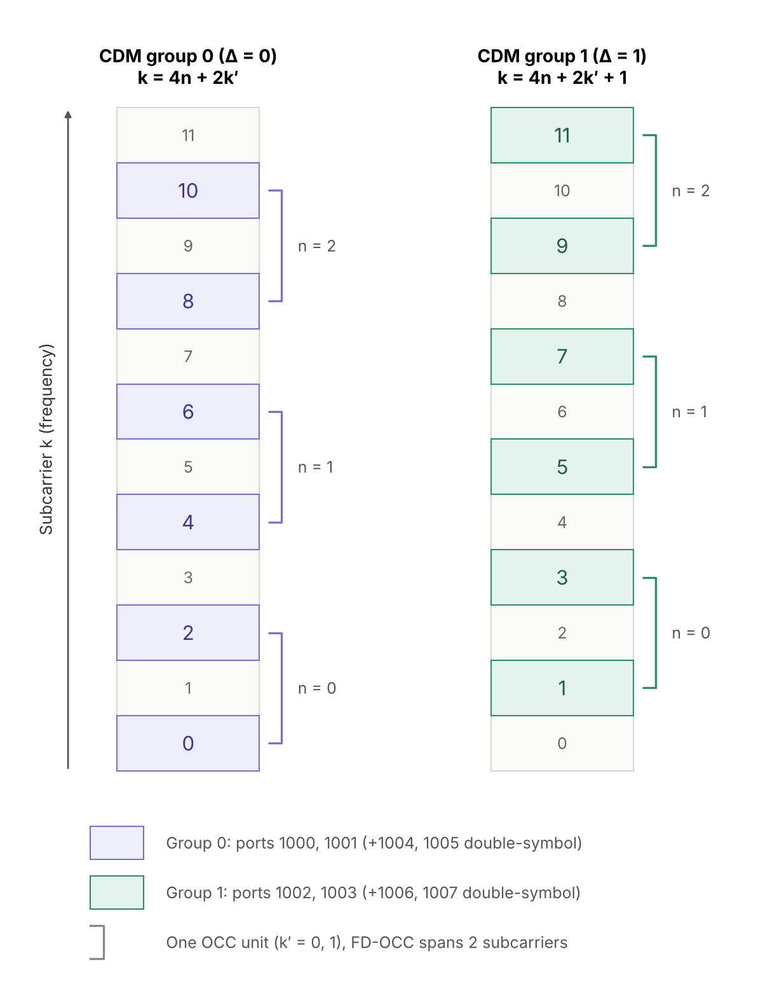

*图1：DMRS CDM group for configuration type 1*

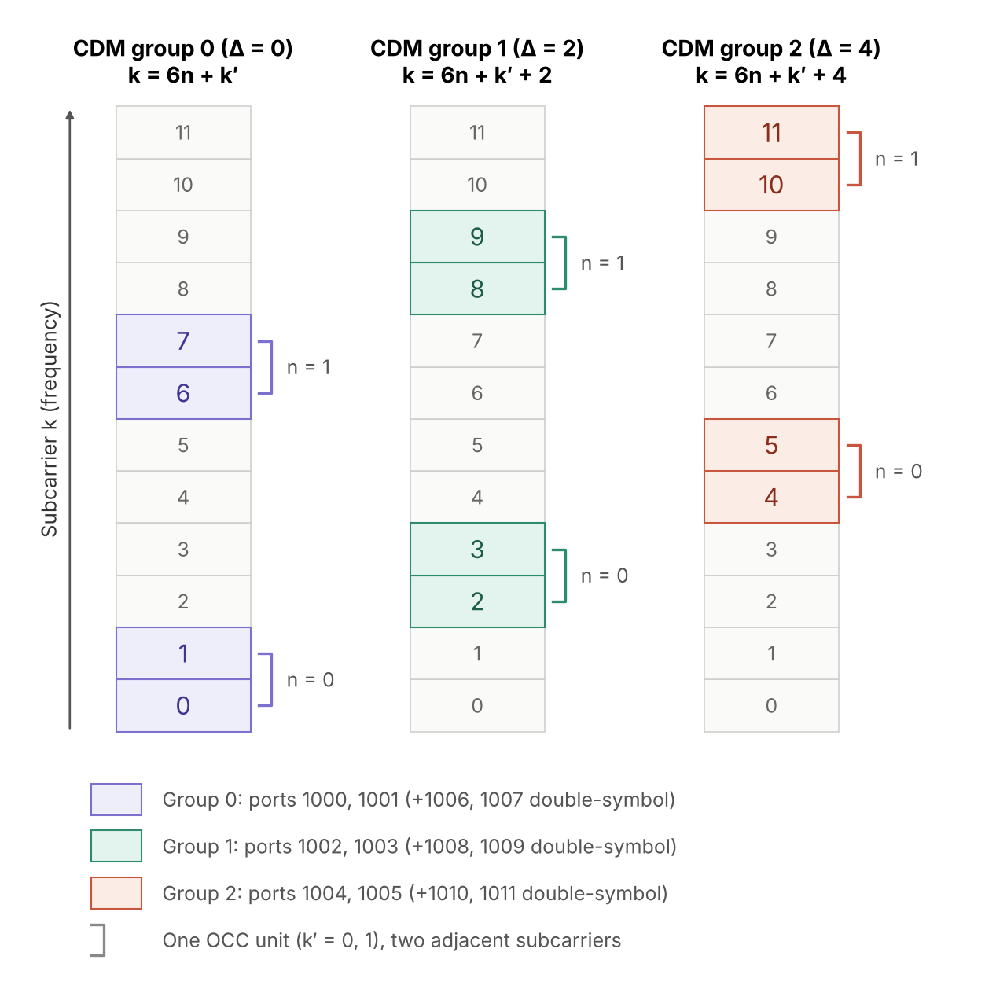

*图2：DMRS CDM group for configuration type 2*

每一层的 PDSCH，都对应一个 DMRS，在以上列出的组里进行选择。例如，可能有如下的使用情况。

a) Configuration Type 1，只有一个 Layer/Port，可以用第一组()，也可以用第二组，还要区分使用的组之外的另外一个组是空闲还是给 PDSCH 使用，这样至少就有四种情况，再加上用组 2 的两种情况，这里一共列出 6 种情况.

 图3 使用组1，但是 组 2 给 PDSCH 使用；

 图 4通过 OCC 方式复用组1，同样，组 2 也是给 PDSCH 使用。

图5 是使用组1，但是 组 2 空闲不给 PDSCH 使用。

图6 是通过 OCC 复用的方式使用组1，同样 组 2 空闲不给 PDSCH 使用。

图7 是使用组2，类似的，组 1 空闲不给 PDSCH 使用。

图8 是通过 OCC 复用的方式使用组2，同样，组 1 空闲不给 PDSCH 使用。

*图3：DMRS CDM group for configuration type 1, use CDM 0, CDM 2 PDSCH*

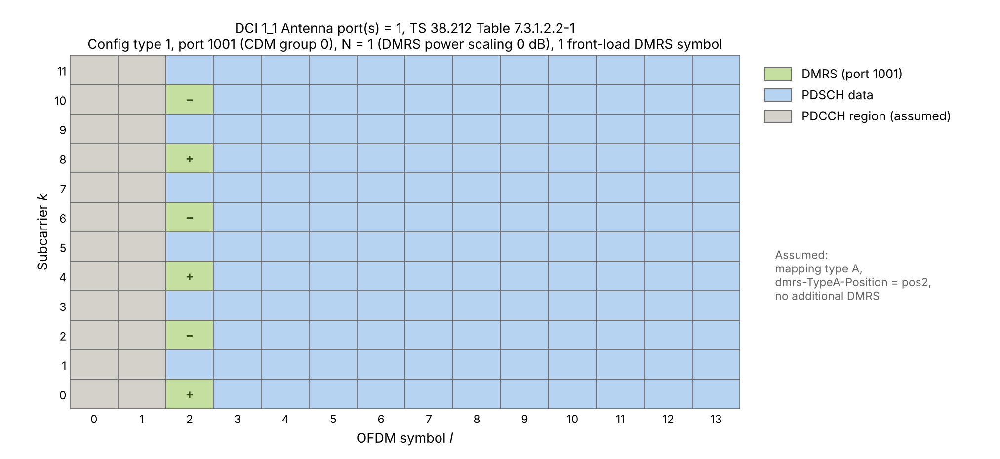

*图4：DMRS CDM group for configuration type 1，use CDM 0 through OCC, CDM 2 PDSCH*

*图5：DMRS CDM group for configuration type 1, use CDM 1, CDM 2 empty*

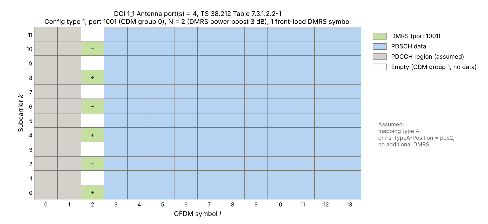

*图6：DMRS CDM group for configuration type 1,, use CDM 1 through OCC, CDM 2 empty*

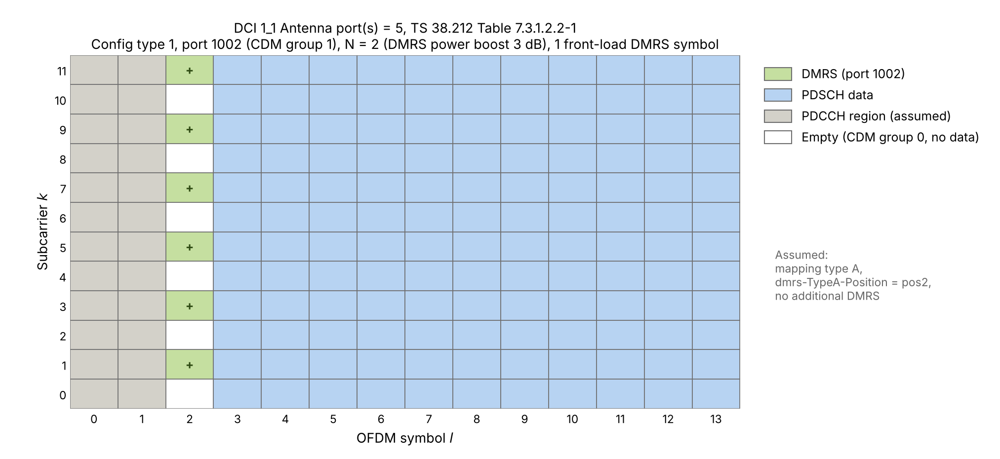

*图7：DMRS CDM group for configuration type 1,, use CDM 2, CDM 1 empty*

*图8：DMRS CDM group for configuration type 1, use CDM 2 through OCC, CDM 1 empty*

b) 使用 DMRS Configuration Type 2. 

如图 9 所示，用了 CDM group 0，其他两个组都给 PDSCH 使用了。

如图13所示，使用了组0， 组 1 空闲，组 2 给 PDSCH 使用了。

如图 17 所示，使用了其中一组，另外两组都是空闲的。

具体分析各种场景和配置，请参考下一节结合 DMRS power scaling的具体描述。

总的原则就是首先确定 DMRS configuration Type，这个决定总的CDM分组数，其次确定总的组数中有多少组用于 DMRS，剩余的组则给 PDSCH 使用，最后在确定的组里面，确定具体每一层使用哪一组以及组内的 OCC 编码(一个组可以通过 OCC 的方式承载两层(Layers/Ports)的 DMRS).

## DMRS power scaling

$$
\beta_{\text{DMRS}}[\text{dB}] = 10 \log_{10} \frac{\text{EPRE}_{\text{PDSCH}}}{\text{EPRE}_{\text{DMRS}}}
$$

其中 EPRE（Energy Per Resource Element）表示每个 RE 上的能量（工程上也常称为每 RE 功率），后文简称为"功率"。注意这里指的是单个 RE 上的功率，而不是整个 OFDM 符号的总功率；DMRS 功率放大时，每个 port 在每个 OFDM 符号上的总功率保持不变。

这个 $$\beta$$， 取值 0，-3 和 -4.77, 分别表示 DMRS 的功率，要在 PDSCH 的功率的基础上再放大 0dB, 3dB 和  4.77dB，即 DMRS 功率要么维持和 PDSCH 一样的功率，要么放大 3dB 或者 4.77dB.

0 dB 的情况：对某个 port 而言，DMRS 所在 OFDM 符号上，只有本 port 所在的
CDM 组（组 0）不承载数据，其余 CDM 组的 RE 都给 PDSCH 使用。configuration type 1
和 type 2 都可以出现这种情况。

3 dB 的情况：对某个 port 而言，除了本 port 所在 CDM 组外，还有 1 个 CDM 组
的 RE 不承载 PDSCH 数据，该 port 在这些 RE 上也不发送信号，其功率可挪到本组的 DMRS
RE 上，因此 DMRS EPRE 放大到 PDSCH EPRE 的 2 倍。configuration type 1（每 RB 6 个
DMRS RE + 6 个空闲 RE）和 configuration type 2（每 RB 4 个 DMRS RE + 4 个空闲 RE，
其余 4 个 RE 仍承载数据）都可以出现这种情况。$$10\log_{10}(2) \approx 3\ \text{dB}$$.

4.77 dB 的情况：仅 configuration type 2 可能出现。对某个 port 而言，三个 CDM
组的 RE 都不承载数据，本 port 只用其中 4 个 RE，因此 DMRS EPRE 放大到 PDSCH EPRE
的 3 倍，即 $$10\log_{10}(3) \approx 4.77\ \text{dB}$$.

那么如何确定用哪种 power scaling 呢？对于下行 PDSCH，则需要 DCI 1\_1 中的一个字段： Antenna port(s), 这个字段是一个 index，用于在 38.212 Table 7.3.1.2.2-1/2/3/4 这四个表格中的一个来查找一行。具体要在哪个表格中查找，依赖于之前的配置参数：DMRS configuration type 1 or 2, DMRS maxLength(最大 symbol 数量 1 或者 2)，来决定用哪个表格。如下表所示：

| **dmrs-Type** | **maxLength** | **Bit Field Length** | **Table in 38.212** |
| :-----------: | :-----------: | :------------------: | :------------------ |
|       1       |       1       |          4           | Table 7.3.1.2.2-1   |
|       1       |       2       |          5           | Table 7.3.1.2.2-2   |
|       2       |       1       |          5           | Table 7.3.1.2.2-3   |
|       2       |       2       |          6           | Table 7.3.1.2.2-4   |

其中，maxLength 表示 DMRS 的最大符号数。某次 PDSCH 实际使用 1 个还是 2 个 DMRS 符号，要看所选那一行的 “Number of front-load symbols” 列（只有 maxLength = 2 对应的表格，即 Table 7.3.1.2.2-2 和 -4，才有这一列）。

确定了表格之后，结合 DCI 1\_1 中的字段，就可以确定 DMRS 以外的 RE 是否留给 PDSCH 使用了。

令 N = "Number of DMRS CDM group(s) without data" in the table  38.212 Table 7.3.1.2.2-1/2/3/4 . 这个 N 表示有多少个组被使用。如果 N 等于总的组数，那么就是DMRS symbol 中，没有给 PDSCH 使用的 RE，反之，N若小于总组数，那么 “总组数 - N” 这些组就给 PDSCH 使用。 

若 N = 1, 则意味着 只使用一个 CDM group(协议规定用 CDM group 0),其他没有使用的 CDM group 给 pdsch 使用，因此， DMRS power scaling 就是 0dB.

对于 Configuration Type  1，一共只有两个 CDM 组。如果 N =2，则表明 DMRS symbol 上的RE不给 PDSCH 使用。这里需要理解的是，对于一个 port ( layer)，只使用一个 CDM 组，若 N = 2，那对于某个 port/layer，因为一个 port 只使用一个 CDM 组，因此，另外一组 CDM 的 RE 就被空闲（相对于这个 port/layer）, 因此，相对这个 port 下的 pdsch 的功率， DMRS 的功率是 PDSCH 功率的两倍，即约 3dB.

对于 Configuration Type 2，一共有三个 CDM 组，如果 N = 2, 则 DMRS 的功率是 PDSCH 功率的两倍，对应 3dB；如果 N = 3，则 DMRS 的功率是 PDSCH 功率的三倍，即对应 4.77dB。

注：38.214 Table 4.1-1 给出的是 PDSCH EPRE 与 DMRS EPRE 之比，因此对应写作
0 dB、−3 dB、−4.77 dB。PUSCH 的规则相同（38.214 Table 6.2.2-1）。

我们来以表格 38.212 Table 7.3.1.2.2-4 为例子再详细讨论一下：

**例子1：N= 1 的情况.** 若38.212 7.3.1.2.2 节的DCI 1\_1 中 Antenna port(s) 是等于 0, 则对应表格的第一行：

**表：38.212 Table 7.3.1.2.2-4 中 value 0 对应的行**

| value | Number of DMRS CDM group(s) without data | DMRS port(s) | Number of front-load symbols |
| :---: | :--------------------------------------: | :----------: | :--------------------------: |
|   0   |                    1                     |      0       |              1               |

资源分配如图 9 所示. 这个用户只使用一个 layer（port 1000），该端口属于 CDM 组 0；由于 $$N=1$$，只有组 0 不承载数据，其他 CDM 组的 RE 都给此用户的 PDSCH 使用，因此，没有额外的功率可以给 DMRS，所以， 这个例子中， DMRS power scaling 是 0 dB.

38.212 Table 7.3.1.2.2-4 的第二行可以和第一行组合使用，给 MU-MIMO 情况下的两个不同 UE 使用，每个 UE 都是一个 layer(port)，则可以这样分配：第一个用户的 DCI 中Antenna port(s) = 0， 第二个用户的DCI 中Antenna port(s) = 1. 因为是 MU-MIMO，所以，两个用户的  RB 资源是重叠的，是靠 beam forming 的 空间分离来相互隔离的。

这里特别强调一下： DMRS 和对应层的 PDSCH 数据使用同一个预编码（波束），所以 DMRS 同样经过空间分离。OCC 正交是在空间分离之上额外加的一层保障。若对 DMRS只做空间分离而不做 OCC 正交（或者 FDM)，则残余干扰会使信道估计有偏，而这个有偏的估计又会用于解调整个 PDSCH，误差会传到所有数据 RE 上。

**表：MU-MIMO 下两个单层 UE 的 DMRS 端口分配（38.212 Table 7.3.1.2.2-4）**

|                             |   UE A    |   UE B    |
| :-------------------------- | :-------: | :-------: |
| DCI 中 Antenna port(s)      |     0     |     1     |
| 端口                        |   1000    |   1001    |
| CDM 组                      |   组 0    |   组 0    |
| 码分的正交掩码 FD-OCC $w_f$ | $[+1,+1]$ | $[+1,-1]$ |
| N：不承载数据的 CDM 组数    |     1     |     1     |
| front-load：DMRS 符号数     |     1     |     1     |

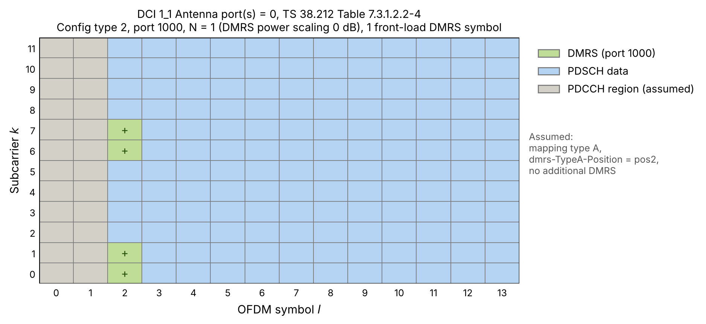

*图9：例子 1：DMRS configuration Type 2, 最多 2 symbols, 第 0 行*

用户 A 的 grid 如图10 所示。

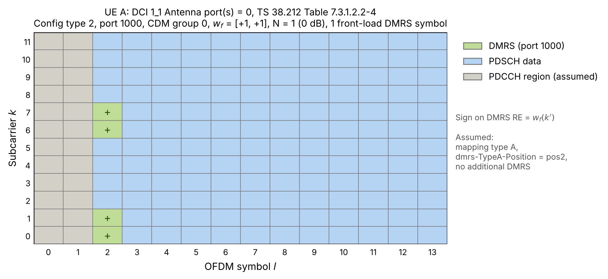

*图10：例子 1：DMRS configuration Type 2, 最多 2 symbols, 第 0 行给用户 A*

用户 B 的 grid 如图11 所示。

*图11：例子 1：DMRS configuration Type 2, 最多 2 symbols, 第 1 行给用户 B*

两个用户在一个 MU-MIMO 组中，资源是复用的，因此，如图12 所示，最终是叠加在一起的（叠加前会分别做一次 beam forming来实现空间分离).

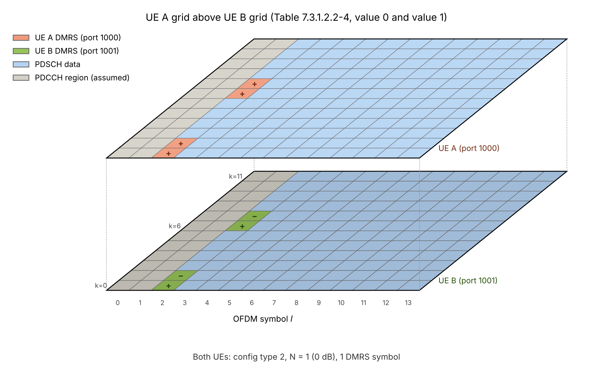

*图12：用户 A 和 B 复用相同的资源*

**例子2：N=2 的情况.** 若38.212 7.3.1.2.2 节的DCI 1\_1 中 Antenna port(s) 是等于 7, 则对应表格的如下一行：

**表：38.212 Table 7.3.1.2.2-4 中 value 7 对应的行**

| **value** | **Number of DMRS CDM group(s) without data** | **DMRS port(s)** | **Number of front-load symbols** |
| :-------: | :------------------------------------------: | :--------------: | :------------------------------: |
|     7     |                      2                       |       0,1        |                1                 |

此 DCI 发给的这个用户，是有两层(layers/ports)，第一层(Layer/Port)的 grid 如图13 所示, 第二层(Layer/Port)的 grid 如图 14 所示.

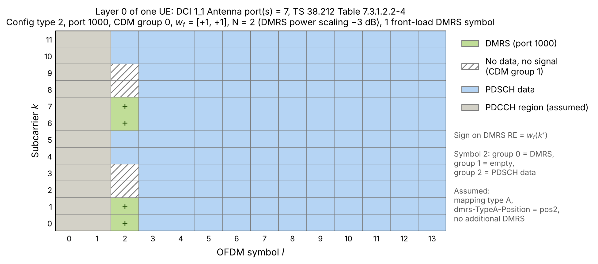

*图13：第一层(Layer/Port)的 grid*

*图14：第二层(Layer/Port)的 grid*

在这种情况下，由于 CDM group 1 (图片中白色的 RE)没有分配给 PDSCH，所以 DMRS EPRE 可以使用空余 RE 的那部分功率，即 DMRS power scaling 是 3dB.

稍微不同一点的一个例子是 DCI 1\_1 中 Antenna port(s) 是等于 23:
**表：38.212 Table 7.3.1.2.2-4 中 value 23 对应的行**

| **value** | **Number of DMRS CDM group(s) without data** | **DMRS port(s)** | **Number of front-load symbols** |
| :-------: | :------------------------------------------: | :--------------: | :------------------------------: |
|    23     |                      2                       |       0,2        |                1                 |

这种情况下，这个 UE 的两层 (Layers/Ports) 各自使用不同的 RE 来放置 DMRS. 一个用 CDM group 0，如图 15所示，一个用 CDM group 1，如图 16所示.

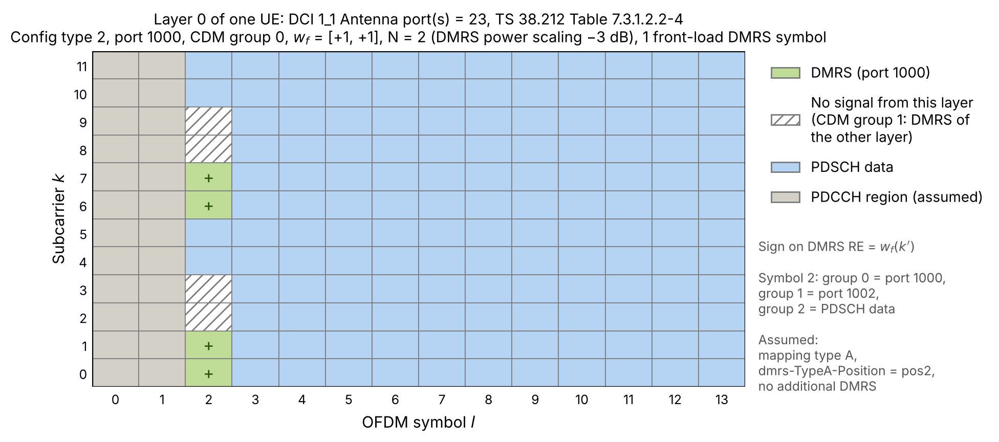

*图15：Value=23情况下的 Layer 0*

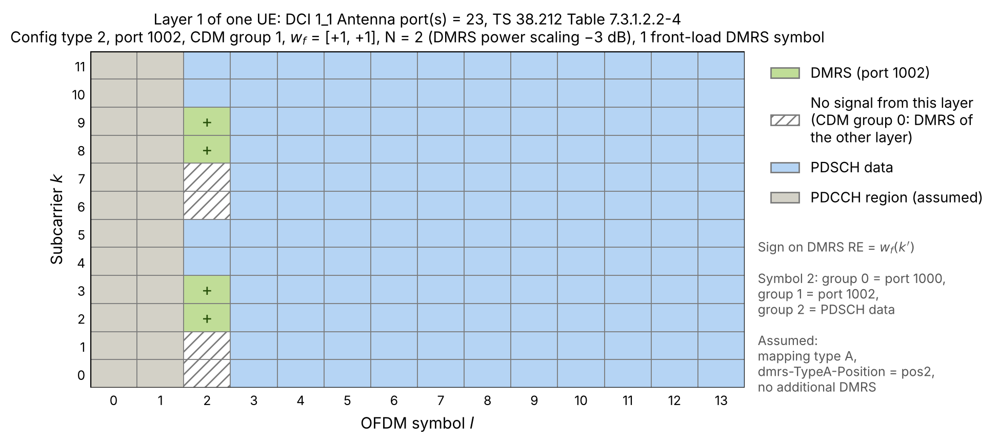

*图16：Value=23情况下的 Layer 1*

对于每一层来讲，它在另一组 CDM 的 RE 上不发送信号，这部分功率可以挪给本层的 DMRS，因此 DMRS EPRE 也是 PDSCH EPRE 的 2 倍，即提升 3 dB（$$\beta_{\text{DMRS}}=-3$$ dB）。

**例子3：N=3 的情况.** 对于DCI 1\_1 中 Antenna port(s) 是等于 22，即 Value = 22 那一行时，支持 4 层(Layers/Ports)，如图 17 所示。

**表：38.212 Table 7.3.1.2.2-4 中 value 22 对应的行**

| value | Number of DMRS CDM group(s) without data | DMRS port(s) | Number of front-load symbols |
| :---: | :--------------------------------------: | :----------: | :--------------------------: |
|  22   |                    3                     |     0-3      |              1               |

层 (layer/port) 0、1 使用 CDM group 0，层 (layer/port) 2、3 使用 CDM group 1，如图 17 所示。此时，对于每一层而言，DMRS 符号上它只在本组的 4 个 RE（三分之一）上发送 DMRS，在其余 8 个 RE（三分之二）上不发送任何信号（其中 4 个是另一组的 DMRS，4 个即 CDM 组 2 完全空闲），因此 DMRS EPRE 可以增加到 PDSCH EPRE 的 3 倍，即提升 4.77 dB（$$\beta_{\text{DMRS}}=-4.77$$ dB）.

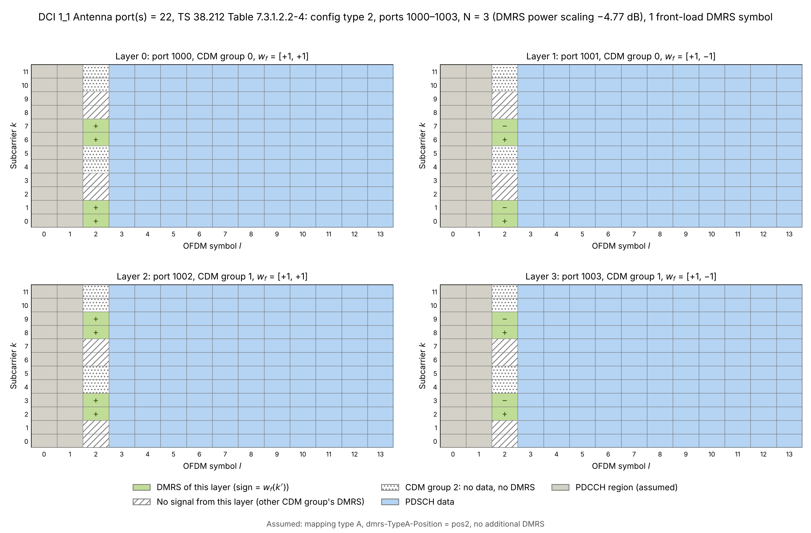

*图17：Value=22 情况下的 4 个 Layers/Ports*