# DMRS for PDSCH

To perform coherent demodulation of the PDSCH, 5G NR sends the demodulation reference signal DMRS (Demodulation Reference Signal) together with the PDSCH inside the PDSCH scheduling bandwidth. The receiver uses the DMRS to estimate the channel and then demodulates the PDSCH data accordingly.

The placement of the DMRS signal on the time-frequency grid uses the formula in section 7.4.1.1.2 of 38.211 (h40), where $$k$$ is the position index in the frequency domain. This index is the RE index, that is, which RE it is:

$$
k = \begin{cases}
		4n + 2k' + \Delta & \text{Configuration type 1} \\
		6n + k' + \Delta & \text{Configuration type 2}
	\end{cases}
$$

Here $$k' \in \{0,1\}$$ corresponds to the REs within one OCC. One OCC contains two REs, which are used by code-division multiplexing and can carry the DMRS of two layers. $$\Delta$$ is defined in table 7.4.1.1.2-1 and table 7.4.1.1.2-2 of 38.211 (h40), which correspond to configuration type 1 and configuration type 2 respectively, and can take the values $$\{0,1\}$$ and $$\{0,2,4\}$$ respectively.

Each time $$n$$ increases by 1, $$k'$$ takes two values, which correspond to the indices of the two REs within one OCC. $$n$$ keeps increasing until the edge of the DMRS bandwidth is reached. Increasing $$n$$ does not increase the number of layers that can carry DMRS; instead, DMRS is placed at different positions in the frequency domain, so that the receiver can estimate the channel coefficients at different frequency positions. If the channel coefficients differ across frequency positions and too few DMRS resources are placed in the frequency domain, the estimated channel coefficients will be inaccurate and performance will degrade. The number of REs placed for one layer within one RB can therefore be calculated with this formula:

$$
\frac{12}{\text{coefficient of } n}\times 2
$$

For example, for configuration type 1, the number of REs placed for one layer within one RB is $$12/4 \times 2 = 6$$; for configuration type 2, the number of REs placed for one layer within one RB is $$12/6 \times 2 = 4$$.

From the number of REs placed and the total of 12 REs in one RB, the number of CDM groups can be calculated.

For configuration type 1, the number of CDM groups is $$12/6=2$$, that is, there are two CDM groups; for configuration type 2, the number of CDM groups is $$12/4=3$$, that is, there are three CDM groups. The RE indices of each group are listed below (assuming the first RB, with indices starting from 0):

For configuration type 1:

The RE indices of the first CDM group are $$[0,2,4,6,8,10]$$.

The RE indices of the second CDM group are $$[1,3,5,7,9,11]$$.

For configuration type 2:

The RE indices of the first CDM group are $$[0,1,6,7]$$.

The RE indices of the second CDM group are $$[2,3,8,9]$$.

The RE indices of the third CDM group are $$[4,5,10,11]$$.

Each CDM group (one OFDM symbol) can carry the DMRS of two layers, so the total number of layers that can be carried is:

For configuration type 1: number of CDM groups * 2 = $$2\times 2 = 4$$

For configuration type 2: number of CDM groups * 2 = $$3\times 2 = 6$$

**Table: Derivation of the RE indices for configuration type 1: $$k = 4n + 2k' + \Delta$$ (within one RB)**

| $$n$$  | $$k'$$ | CDM group 0 ($$\Delta=0$$) | CDM group 1 ($$\Delta=1$$) |
| :--: | :--: | :--------------------- | :--------------------- |
|  0   |  0   | $$4\cdot0+2\cdot0+0=0$$  | $$4\cdot0+2\cdot0+1=1$$  |
|  0   |  1   | $$4\cdot0+2\cdot1+0=2$$  | $$4\cdot0+2\cdot1+1=3$$  |
|  1   |  0   | $$4\cdot1+2\cdot0+0=4$$  | $$4\cdot1+2\cdot0+1=5$$  |
|  1   |  1   | $$4\cdot1+2\cdot1+0=6$$  | $$4\cdot1+2\cdot1+1=7$$  |
|  2   |  0   | $$4\cdot2+2\cdot0+0=8$$  | $$4\cdot2+2\cdot0+1=9$$  |
|  2   |  1   | $$4\cdot2+2\cdot1+0=10$$ | $$4\cdot2+2\cdot1+1=11$$ |

**Table: Derivation of the RE indices for configuration type 2: $$k = 6n + k' + \Delta$$ (within one RB)**

| $$n$$  | $$k'$$ | CDM group 0 ($$\Delta=0$$) | CDM group 1 ($$\Delta=2$$) | CDM group 2 ($$\Delta=4$$) |
| :--: | :--: | :--------------------- | :--------------------- | :--------------------- |
|  0   |  0   | $$6\cdot0+0+0=0$$        | $$6\cdot0+0+2=2$$        | $$6\cdot0+0+4=4$$        |
|  0   |  1   | $$6\cdot0+1+0=1$$        | $$6\cdot0+1+2=3$$        | $$6\cdot0+1+4=5$$        |
|  1   |  0   | $$6\cdot1+0+0=6$$        | $$6\cdot1+0+2=8$$        | $$6\cdot1+0+4=10$$       |
|  1   |  1   | $$6\cdot1+1+0=7$$        | $$6\cdot1+1+2=9$$        | $$6\cdot1+1+4=11$$       |

From the description above, the grouping diagrams can be drawn. Figure 1 shows DMRS configuration type 1: the left part of the figure is one group and the right part is the other group; each group has 6 REs, and every two REs form one OCC. Figure 2 shows DMRS configuration type 2, which has three groups in total: the left part of the figure is one group, the middle part is one group and the right part is one group; each group has 4 REs, and every two REs form one OCC.

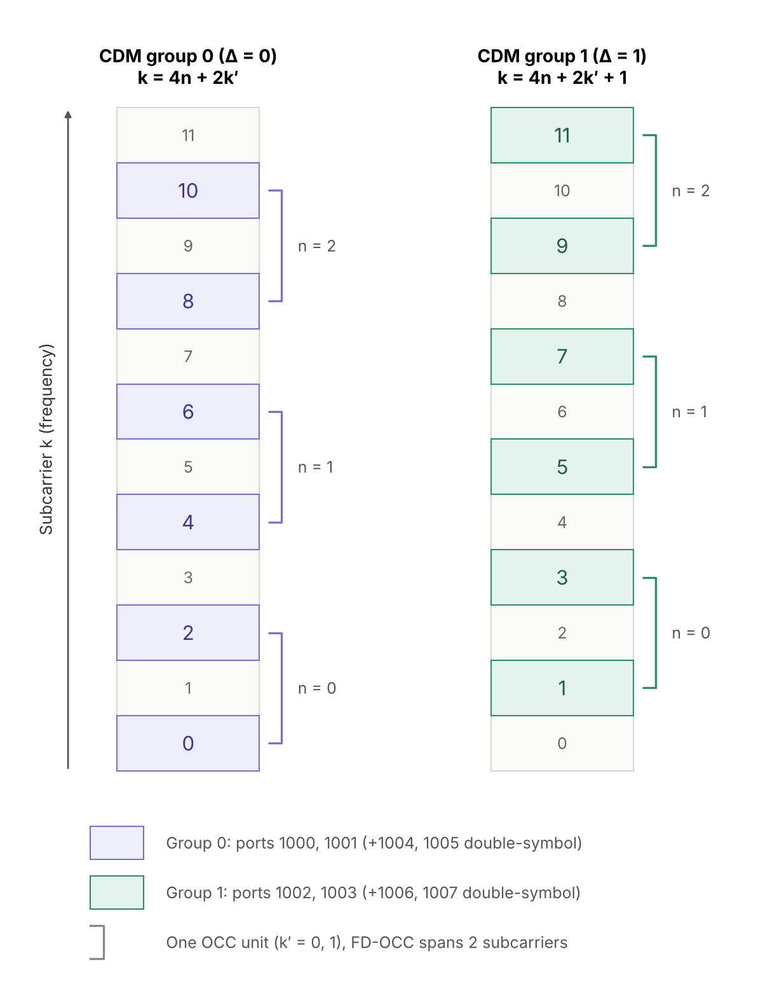

*Figure 1: DMRS CDM group for configuration type 1*

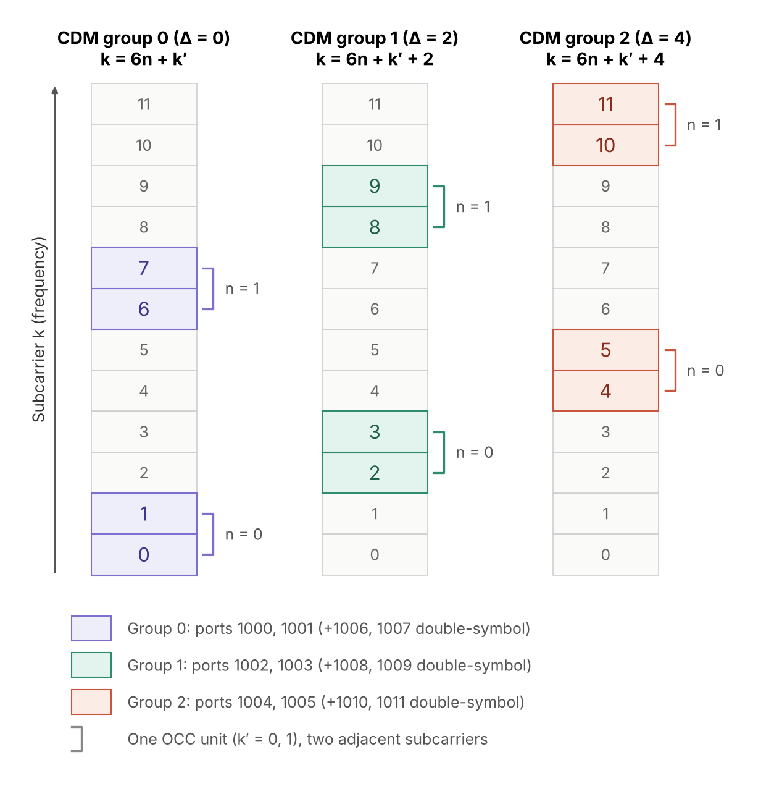

*Figure 2: DMRS CDM group for configuration type 2*

The PDSCH of each layer corresponds to one DMRS, chosen from the groups listed above. For example, the following usage cases are possible.

a) Configuration type 1 with only one layer/port. CDM group 0 can be used, or CDM group 1 can be used; in addition, we need to distinguish whether the other group (the one not used) is idle or given to the PDSCH, and for each case whether OCC multiplexing is used. The specification states that only CDM group 0 is used when N = 1 (see below), so there are 6 cases in total.

Figure 3 uses group 0, and group 1 is used by the PDSCH;

Figure 4 multiplexes group 0 through OCC, and likewise group 1 is used by the PDSCH.

Figure 5 uses group 0, and group 1 is idle and not given to the PDSCH.

Figure 6 uses group 0 multiplexed through OCC, and likewise group 1 is idle and not given to the PDSCH.

Figure 7 uses group 1, and similarly group 0 is idle and not given to the PDSCH.

Figure 8 uses group 1 multiplexed through OCC, and likewise group 0 is idle and not given to the PDSCH.

*Figure 3: DMRS CDM group for configuration type 1, use CDM 0, CDM 1 PDSCH*

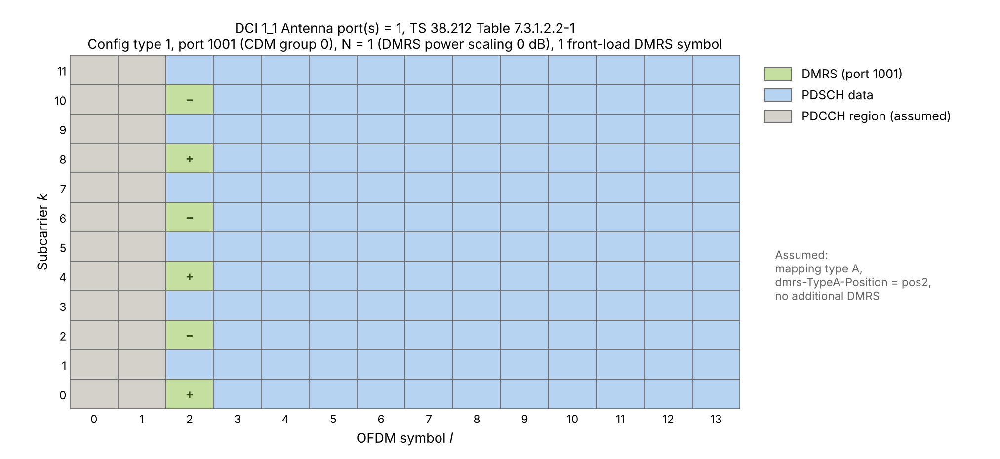

*Figure 4: DMRS CDM group for configuration type 1, use CDM 0 through OCC, CDM 1 PDSCH*

*Figure 5: DMRS CDM group for configuration type 1, use CDM 0, CDM 1 empty*

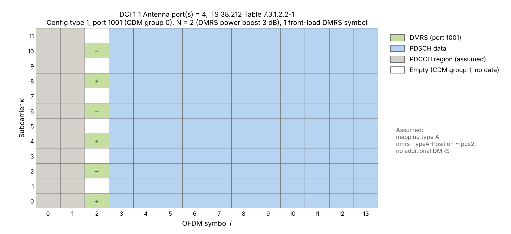

*Figure 6: DMRS CDM group for configuration type 1, use CDM 0 through OCC, CDM 1 empty*

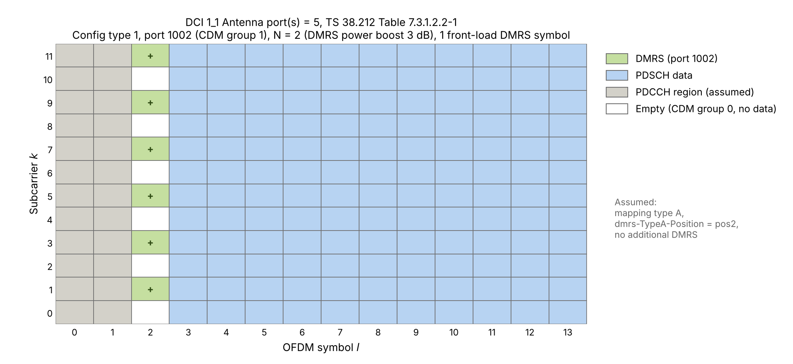

*Figure 7: DMRS CDM group for configuration type 1, use CDM 1, CDM 0 empty*

*Figure 8: DMRS CDM group for configuration type 1, use CDM 1 through OCC, CDM 0 empty*

b) Using DMRS configuration type 2.

As shown in Figure 9, CDM group 0 is used and the other two groups are both used by the PDSCH.

As shown in Figure 13, group 0 is used, group 1 is idle, and group 2 is used by the PDSCH.

As shown in Figure 17, one of the groups is used and the other two groups are both idle.

For the detailed analysis of the various scenarios and configurations, please refer to the next section, which describes DMRS power scaling.

The general principle is: first determine the DMRS configuration type, which determines the total number of CDM groups; then determine how many of the total groups are used for DMRS, with the remaining groups given to the PDSCH; finally, within the groups determined, decide which group each layer uses and the OCC code within the group (one group can carry the DMRS of two layers (layers/ports) through OCC).

## DMRS power scaling

$$
\beta_{\text{DMRS}}[\text{dB}] = 10 \log_{10} \frac{\text{EPRE}_{\text{PDSCH}}}{\text{EPRE}_{\text{DMRS}}}
$$

Here EPRE (Energy Per Resource Element) is the energy on each RE (in engineering it is also often called the power per RE), and is referred to simply as "power" below. Note that this means the power on a single RE, not the total power of the whole OFDM symbol; when the DMRS power is boosted, the total power of each port on each OFDM symbol stays unchanged.

This $$\beta$$ takes the values 0, -3 and -4.77, which respectively mean that the DMRS power is boosted by 0 dB, 3 dB and 4.77 dB on top of the PDSCH power; that is, the DMRS power either stays the same as the PDSCH power, or is boosted by 3 dB or 4.77 dB.

The 0 dB case: for a given port, on the OFDM symbol carrying the DMRS, only the CDM group of this port (group 0) carries no data, and the REs of the remaining CDM groups are all given to the PDSCH. This case can occur for both configuration type 1 and type 2.

The 3 dB case: for a given port, besides the CDM group of this port, there is 1 more CDM group whose REs carry no PDSCH data. The port also sends no signal on those REs, and its power can be moved to the DMRS REs of its own group, so the DMRS EPRE is boosted to 2 times the PDSCH EPRE. This case can occur for both configuration type 1 (6 DMRS REs + 6 idle REs per RB) and configuration type 2 (4 DMRS REs + 4 idle REs per RB, with the remaining 4 REs still carrying data). $$10\log_{10}(2) \approx 3\ \text{dB}$$.

The 4.77 dB case: this can only occur for configuration type 2. For a given port, the REs of all three CDM groups carry no data, and this port uses only 4 of them, so the DMRS EPRE is boosted to 3 times the PDSCH EPRE, that is, $$10\log_{10}(3) \approx 4.77\ \text{dB}$$.

So how do we determine which power scaling to use? For the downlink PDSCH, a field in DCI 1\_1 is needed: Antenna port(s). This field is an index used to look up one row in one of the four tables 38.212 Table 7.3.1.2.2-1/2/3/4. Which table to look in depends on previously configured parameters: DMRS configuration type 1 or 2 and DMRS maxLength (the maximum number of symbols, 1 or 2). This is shown in the table below:

| **dmrs-Type** | **maxLength** | **Bit Field Length** | **Table in 38.212** |
| :-----------: | :-----------: | :------------------: | :------------------ |
|       1       |       1       |          4           | Table 7.3.1.2.2-1   |
|       1       |       2       |          5           | Table 7.3.1.2.2-2   |
|       2       |       1       |          5           | Table 7.3.1.2.2-3   |
|       2       |       2       |          6           | Table 7.3.1.2.2-4   |

Here maxLength is the maximum number of DMRS symbols. Whether a given PDSCH actually uses 1 or 2 DMRS symbols depends on the "Number of front-load symbols" column of the selected row (only the tables corresponding to maxLength = 2, that is, Table 7.3.1.2.2-2 and -4, have this column).

Once the table has been determined, the field in DCI 1\_1 tells us whether the REs other than the DMRS are left for the PDSCH.

Let N = "Number of DMRS CDM group(s) without data" in the table 38.212 Table 7.3.1.2.2-1/2/3/4. This N indicates how many groups are used. If N equals the total number of groups, then no RE in the DMRS symbol is given to the PDSCH. Conversely, if N is smaller than the total number of groups, then the "total number of groups - N" groups are given to the PDSCH.

If N = 1, this means only one CDM group is used (the specification says CDM group 0 is used), and the other unused CDM groups are given to the PDSCH, so the DMRS power scaling is 0 dB.

For configuration type 1 there are only two CDM groups in total. If N = 2, the REs on the DMRS symbol are not given to the PDSCH. What needs to be understood here is that a port (layer) uses only one CDM group; if N = 2, then for a given port/layer the REs of the other CDM group are idle (relative to this port/layer). Therefore, relative to the PDSCH power under this port, the DMRS power is twice the PDSCH power, that is, about 3 dB.

For configuration type 2 there are three CDM groups in total. If N = 2, the DMRS power is twice the PDSCH power, corresponding to 3 dB; if N = 3, the DMRS power is three times the PDSCH power, corresponding to 4.77 dB.

Note: what 38.214 Table 4.1-1 gives is the ratio of the PDSCH EPRE to the DMRS EPRE, so it is written as 0 dB, −3 dB and −4.77 dB accordingly. The rule for the PUSCH is the same (38.214 Table 6.2.2-1).

Let us discuss this in more detail using the table 38.212 Table 7.3.1.2.2-4 as an example:

**Example 1: the case N = 1.** If Antenna port(s) in DCI 1\_1 (section 7.3.1.2.2 of 38.212) is equal to 0, it corresponds to the first row of the table:

**Table: the row of 38.212 Table 7.3.1.2.2-4 corresponding to value 0**

| value | Number of DMRS CDM group(s) without data | DMRS port(s) | Number of front-load symbols |
| :---: | :--------------------------------------: | :----------: | :--------------------------: |
|   0   |                    1                     |      0       |              1               |

The resource allocation is shown in Figure 9. This user uses only one layer (port 1000), and this port belongs to CDM group 0. Since $$N=1$$, only group 0 carries no data, and the REs of the other CDM groups are all used by the PDSCH of this user. Therefore there is no extra power available for the DMRS, so in this example the DMRS power scaling is 0 dB.

The second row of 38.212 Table 7.3.1.2.2-4 can be combined with the first row and used by two different UEs in the MU-MIMO case, each UE having one layer (port). They can be allocated as follows: in the DCI of the first user, Antenna port(s) = 0; in the DCI of the second user, Antenna port(s) = 1. Because this is MU-MIMO, the RB resources of the two users overlap, and they are isolated from each other by the spatial separation of beamforming.

One thing to stress here: the DMRS and the PDSCH data of the corresponding layer use the same precoding (beam), so the DMRS is also spatially separated. The OCC orthogonality is an additional layer of protection on top of the spatial separation. If the DMRS had only spatial separation without OCC orthogonality (or FDM), the residual interference would bias the channel estimate, and this biased estimate would then be used to demodulate the whole PDSCH, so the error would propagate to all data REs.

**Table: DMRS port allocation of two single-layer UEs under MU-MIMO (38.212 Table 7.3.1.2.2-4)**

|                             |   UE A    |   UE B    |
| :-------------------------- | :-------: | :-------: |
| Antenna port(s) in DCI      |     0     |     1     |
| Port                        |   1000    |   1001    |
| CDM group                   |  group 0  |  group 0  |
| Orthogonal cover code FD-OCC $$w_f$$ | $$[+1,+1]$$ | $$[+1,-1]$$ |
| N: number of CDM groups without data |     1     |     1     |
| front-load: number of DMRS symbols   |     1     |     1     |

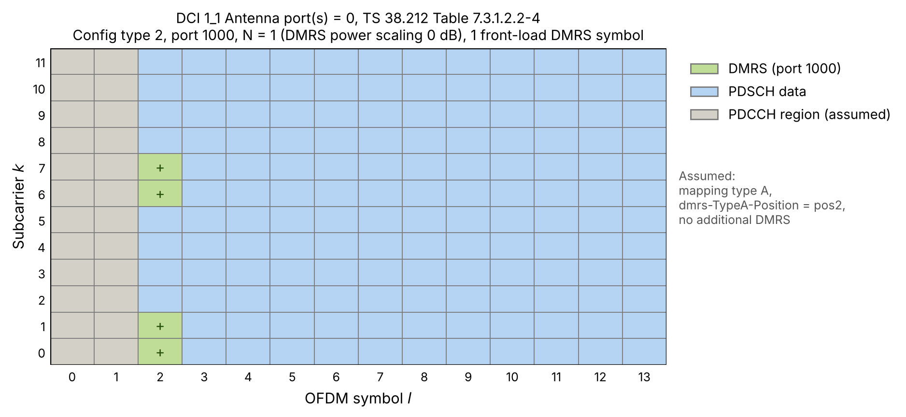

*Figure 9: Example 1: DMRS configuration Type 2, up to 2 symbols, row 0*

The grid of user A is shown in Figure 10.

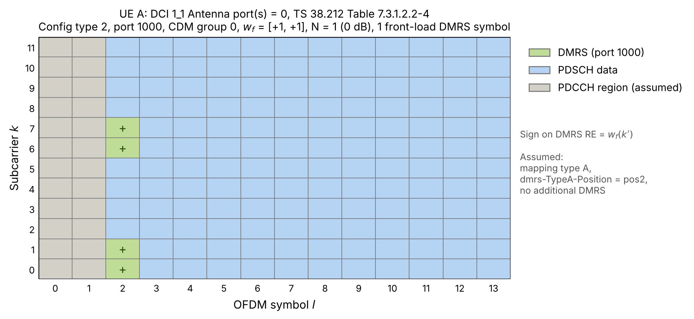

*Figure 10: Example 1: DMRS configuration Type 2, up to 2 symbols, row 0 for user A*

The grid of user B is shown in Figure 11.

*Figure 11: Example 1: DMRS configuration Type 2, up to 2 symbols, row 1 for user B*

The two users are in one MU-MIMO group and their resources are multiplexed, so, as shown in Figure 12, they are finally superposed on each other (beamforming is applied to each of them separately before the superposition, to achieve the spatial separation).

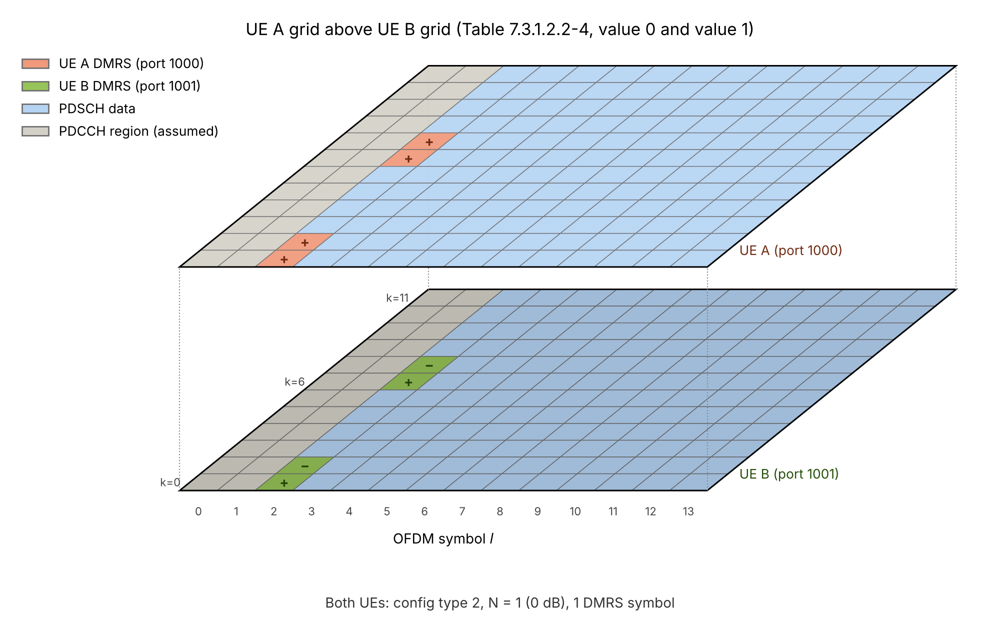

*Figure 12: User A and user B multiplex the same resources*

**Example 2: the case N = 2.** If Antenna port(s) in DCI 1\_1 (section 7.3.1.2.2 of 38.212) is equal to 7, it corresponds to the following row of the table:

**Table: the row of 38.212 Table 7.3.1.2.2-4 corresponding to value 7**

| **value** | **Number of DMRS CDM group(s) without data** | **DMRS port(s)** | **Number of front-load symbols** |
| :-------: | :------------------------------------------: | :--------------: | :------------------------------: |
|     7     |                      2                       |       0,1        |                1                 |

The user this DCI is sent to has two layers (layers/ports). The grid of the first layer (layer/port) is shown in Figure 13, and the grid of the second layer (layer/port) is shown in Figure 14.

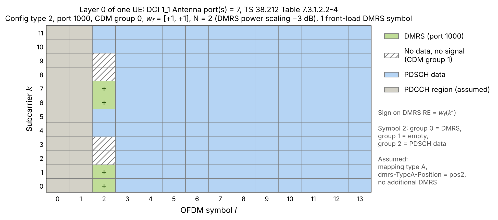

*Figure 13: grid of the first layer (layer/port)*

*Figure 14: grid of the second layer (layer/port)*

In this case, since CDM group 1 (the white REs in the figures) is not allocated to the PDSCH, the DMRS EPRE can use the power of those spare REs, that is, the DMRS power scaling is 3 dB.

A slightly different example is when Antenna port(s) in DCI 1\_1 is equal to 23:

**Table: the row of 38.212 Table 7.3.1.2.2-4 corresponding to value 23**

| **value** | **Number of DMRS CDM group(s) without data** | **DMRS port(s)** | **Number of front-load symbols** |
| :-------: | :------------------------------------------: | :--------------: | :------------------------------: |
|    23     |                      2                       |       0,2        |                1                 |

In this case, the two layers (layers/ports) of this UE place their DMRS on different REs. One uses CDM group 0, as shown in Figure 15, and the other uses CDM group 1, as shown in Figure 16.

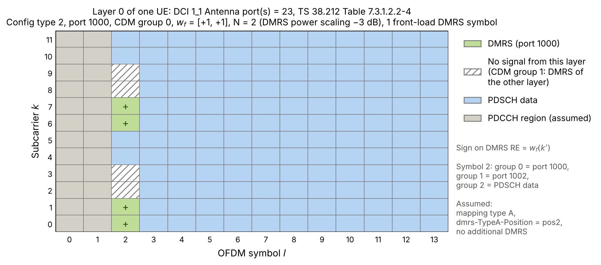

*Figure 15: Layer 0 for value = 23*

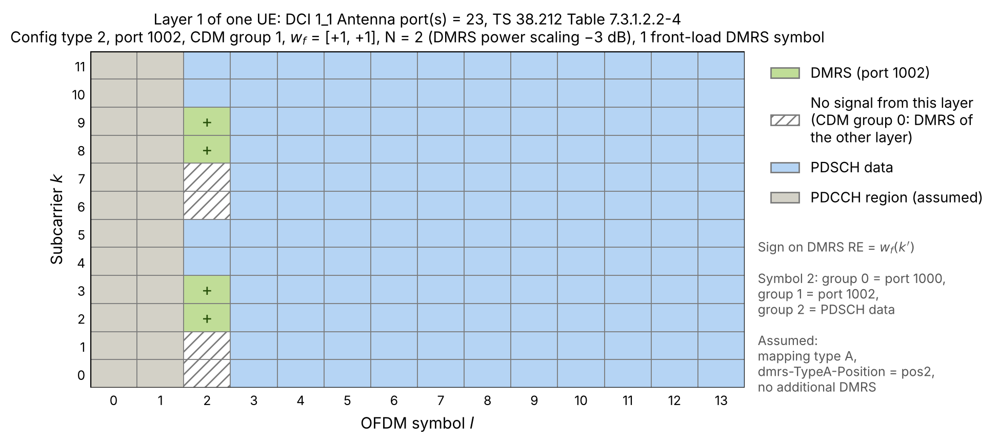

*Figure 16: Layer 1 for value = 23*

For each layer, it sends no signal on the REs of the other CDM group, and this power can be moved to the DMRS of this layer. The DMRS EPRE is therefore also 2 times the PDSCH EPRE, that is, boosted by 3 dB ($$\beta_{\text{DMRS}}=-3$$ dB).

**Example 3: the case N = 3.** When Antenna port(s) in DCI 1\_1 is equal to 22, that is, the row with value = 22, 4 layers (layers/ports) are supported, as shown in Figure 17.

**Table: the row of 38.212 Table 7.3.1.2.2-4 corresponding to value 22**

| value | Number of DMRS CDM group(s) without data | DMRS port(s) | Number of front-load symbols |
| :---: | :--------------------------------------: | :----------: | :--------------------------: |
|  22   |                    3                     |     0-3      |              1               |

Layers (layer/port) 0 and 1 use CDM group 0, and layers (layer/port) 2 and 3 use CDM group 1, as shown in Figure 17. In this case, for each layer, on the DMRS symbol it sends DMRS only on the 4 REs of its own group (one third), and sends no signal on the other 8 REs (two thirds); of these, 4 carry the DMRS of the other group, and the 4 REs of CDM group 2 are completely idle. The DMRS EPRE can therefore be increased to 3 times the PDSCH EPRE, that is, boosted by 4.77 dB ($$\beta_{\text{DMRS}}=-4.77$$ dB).

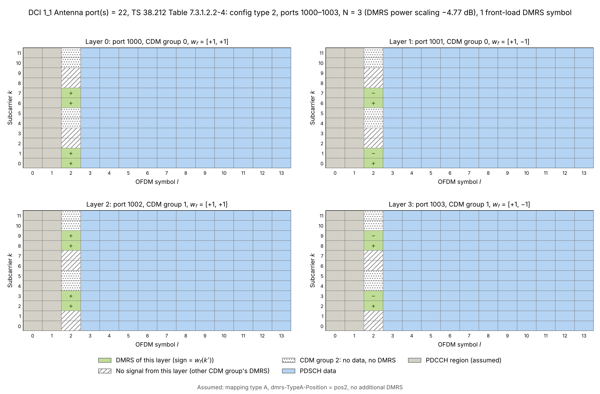

*Figure 17: the 4 layers/ports for value = 22*
