## (1) Introduction to GPU Programming

This article discusses GPU kernel programming from a fairly low-level, hardware-oriented point of view. The main topic is how multiple threads and multiple cores are scheduled at the hardware level. The article uses the AMD MI300X as its example; other GPUs are similar, and NVIDIA GPUs work in much the same way, only with some slightly different terminology.

Let us start with the simplest possible piece of code:

```cpp
#include <hip/hip_runtime.h>
#include <stdio.h>

// GPU kernel: element-wise addition C[i] = A[i] + B[i]
__global__ void vec_add(const float* A, const float* B, float* C, int N)
{
    int i = blockIdx.x * blockDim.x + threadIdx.x;
    if (i < N) C[i] = A[i] + B[i];
}

int main()
{
    const int N = 1024;
    size_t sz = N * sizeof(float);

    // Allocate and initialize data on the host
    float *h_A = new float[N];
    float *h_B = new float[N];
    float *h_C = new float[N];
    for (int i = 0; i < N; i++) { h_A[i] = (float)i; h_B[i] = (float)(N - i); }

    // Allocate device memory on the GPU and copy the data over
    float *d_A, *d_B, *d_C;
    hipMalloc(&d_A, sz);
    hipMalloc(&d_B, sz);
    hipMalloc(&d_C, sz);
    hipMemcpy(d_A, h_A, sz, hipMemcpyHostToDevice);
    hipMemcpy(d_B, h_B, sz, hipMemcpyHostToDevice);

    // 256 threads per block; the grid covers all N elements
    dim3 block(256);
    dim3 grid((N + 255) / 256);
    vec_add<<<grid, block>>>(d_A, d_B, d_C, N);

    // Copy the result back to the host and check it
    hipMemcpy(h_C, d_C, sz, hipMemcpyDeviceToHost);
    printf("C[0]=%g  C[512]=%g  C[1023]=%g\n", h_C[0], h_C[512], h_C[1023]);

    // Release resources
    hipFree(d_A); hipFree(d_B); hipFree(d_C);
    delete[] h_A; delete[] h_B; delete[] h_C;
    return 0;
}
```

This code is very simple: it adds two arrays of 1024 elements element by element and puts the results into a third array.

The function vec\_add is the one that runs on the GPU. Notice that there is no for loop inside this function that adds up all the elements. The function adds just one pair of elements and puts the result into the corresponding position of the third array, that is, $$C[i] = A[i] + B[i]$$. In other words, apart from computing the position i beforehand, the function performs only a single addition.

Put simply, the GPU sends this one small function to hundreds or even thousands of execution entities at the same time, and each entity is responsible for the computation at one position.

So how does the GPU allocate and schedule all of this?

Let us first look at the architecture in Figure 1:

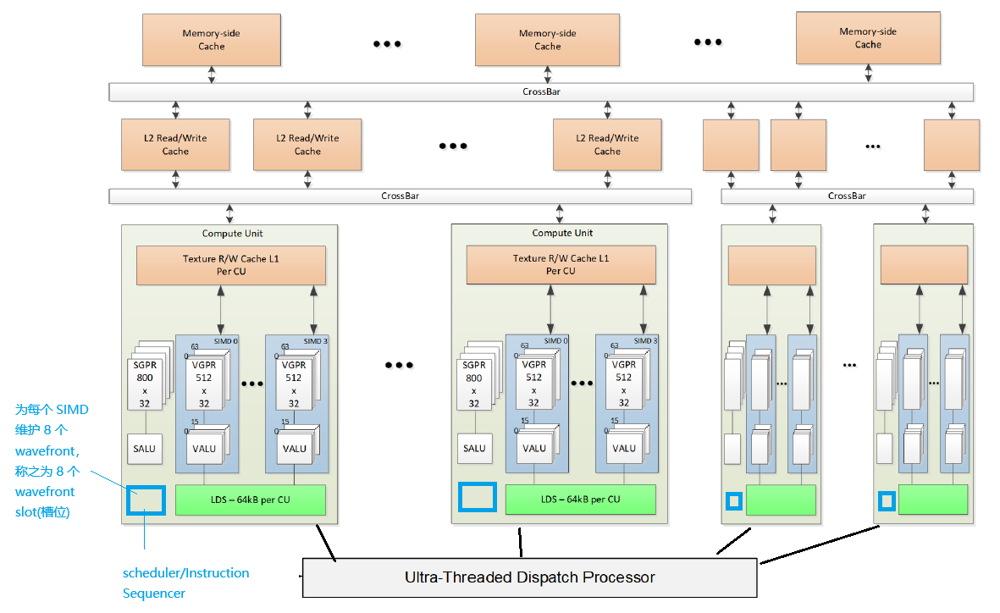

*Figure 1: AMD GPU MI300X architecture*

We will start from the lowest level and work upward. Once the lower levels are understood, it is much easier to see how the upper levels arrange and schedule them.

### The SIMD level

The module that actually executes code at the lowest level, that is, that executes one thread (one run of the function vec\_add), is the VALU (note: in reality it is not 100% the VALU that executes everything; some branch and jump instructions are executed by the SALU, which we will cover later). The block diagram shows 16 VALUs. These 16 VALUs execute the same instruction at the same time, but the registers the instruction operates on are different. Take, for example, the instruction:

```
v_add_f16  v0, v1, v2
```

16 threads execute it simultaneously, but v0, v1 and v2 refer to 16 different sets of v0, v1, v2 in the 64 VGPRs above.

For example:

In the first cycle, 16 threads use the v0, v1, v2 of VGPR lanes 0--15;

In the second cycle, 16 threads use the v0, v1, v2 of VGPR lanes 16--31;

In the third cycle, 16 threads use the v0, v1, v2 of VGPR lanes 32--47;

In the fourth cycle, 16 threads use the v0, v1, v2 of VGPR lanes 48--63.

All 64 of these threads must have executed the instruction before the hardware switches to another group of 64 threads. These 64 threads proceed in perfect lockstep; in AMD terminology they are called a wavefront, or simply a wave, and in the CUDA world they are called a warp.

As you can see, there are 4 SIMDs side by side, and each SIMD has 64 threads executing on it. Threads on different SIMDs are not required to proceed in lockstep; only the 64 threads inside one SIMD move in lockstep.

If the 64 threads on some SIMD have to wait, for example for data, the scheduler one level up suspends those 64 threads and immediately schedules another 64 threads that are ready, that is, it schedules a different wavefront.

In AMD terminology, a thread is sometimes also called a lane.

### The CU level

The architecture diagram shows that one CU (Compute Unit) manages 4 SIMDs, so a CU can run 64 * 4 threads at the same time.

When the wavefront (64 threads) on a SIMD is stuck, that is, waiting for some other condition to become ready, the CU switches seamlessly and with zero delay to another wavefront that is ready. Each SIMD supports up to 8 wavefronts between which zero-delay switching is possible, and each of them occupies what is called a slot. A SIMD therefore has 8 slots, and when the CU issues wavefronts to these 8 slots it must also take the available resources into account.

To make this zero-delay switching possible, the registers used by a wavefront must already be held in the VGPRs. Depending on how many registers each thread uses, we can work out the maximum number of slots that can be used.

**Dynamic allocation at run time and occupancy**

When a kernel is launched and the CU scheduler is about to issue wavefronts to the 8 slots of a SIMD, it dynamically carves a contiguous region out of the register pool for each wavefront, according to the per-thread VGPR requirement reported by the compiler.

This leads to three different occupancy scenarios:

**Scenario A: register bound -- the slots cannot all be filled**

Suppose the compiler reports that the kernel is very complex and each thread needs 128 VGPRs.
A thread (lane) in a wavefront then occupies 128 physical registers.
512/128 = 4, so at most 4 wavefronts fit.
Result: of the 8 control slots on the SIMD only 4 are filled and the other 4 stay empty. Although there are empty slots, there are no registers left, so the scheduler cannot put in another wavefront.

**Scenario B: perfect balance**

Suppose the kernel is well optimized and each thread uses exactly 64 VGPRs.
The total capacity of the register pool is 512 / 64 = 8.
Result: the register pool is exactly enough for 8 wavefronts. All 8 slots are used and all the physical registers are used, which gives 100% theoretical occupancy.

**Scenario C: slot (wave) bound -- registers are left idle**

Suppose the kernel is very simple and each thread needs only 32 VGPRs.
By register capacity alone, 512 / 32 = 16 wavefronts would fit.
Result: even though more than half of the physical registers are still free, the SIMD hardware is designed with only 8 wavefront slots (a hard limit of the control logic), so at most 8 wavefronts can run. The remaining register space is simply wasted.


### Terminology comparison

| **CUDA** | **HIP** | **OpenCL™** |
|---|---|---|
| grid | grid | NDRange |
| block | block | work group |
| thread | thread (lane) | work item |
| warp | wavefront | sub-group (?) |


### rocminfo

The information below was obtained by running the rocminfo command on an MI300X.

The following three entries are relevant to our discussion so far:
```
SIMDs per CU:            4
Wavefront Size:          64(0x40)
Max Waves Per CU:        32(0x20)
Max Work-item Per CU:    2048(0x800)
```

SIMDs per CU: a CU contains 4 SIMDs.

Wavefront Size: the number of threads (lanes, work-items) executing simultaneously in one SIMD.

Max Waves Per CU: the maximum number of wavefronts (warps) that can be resident in one CU. A CU has 4 SIMDs, so we can infer that one SIMD can hold 32/4 = 8 wavefronts.

Max Work-item Per CU: the maximum number of threads resident in a CU is 8*4*64 = 2048.


```
ROCk module version 6.16.13 is loaded
=====================
HSA System Attributes
=====================
Runtime Version:         1.18
Runtime Ext Version:     1.15
System Timestamp Freq.:  1000.000000MHz
Sig. Max Wait Duration:  18446744073709551615 (0xFFFFFFFFFFFFFFFF) (timestamp count)
Machine Model:           LARGE
System Endianness:       LITTLE
Mwaitx:                  DISABLED
XNACK enabled:           NO
DMAbuf Support:          YES
VMM Support:             YES

==========
HSA Agents
==========
*******
Agent 1
*******
Name:                    INTEL(R) XEON(R) PLATINUM 8568Y+
Uuid:                    CPU-XX
Marketing Name:          INTEL(R) XEON(R) PLATINUM 8568Y+
Vendor Name:             CPU
Feature:                 None specified
Profile:                 FULL_PROFILE
Float Round Mode:        NEAR
Max Queue Number:        0(0x0)
Queue Min Size:          0(0x0)
Queue Max Size:          0(0x0)
Queue Type:              MULTI
Node:                    0
Device Type:             CPU
Cache Info:
L1:                      32768(0x8000) KB
Chip ID:                 0(0x0)
ASIC Revision:           0(0x0)
Cacheline Size:          64(0x40)
Max Clock Freq. (MHz):   0
BDFID:                   0
Internal Node ID:        0
Compute Unit:            20
SIMDs per CU:            0
Shader Engines:          0
Shader Arrs. per Eng.:   0
WatchPts on Addr. Ranges:1
Memory Properties:
Features:                None
Pool Info:
Pool 1
Segment:                 GLOBAL; FLAGS: FINE GRAINED
Size:                    247409304(0xebf2a98) KB
Allocatable:             TRUE
Alloc Granule:           4KB
Alloc Recommended Granule:4KB
Alloc Alignment:         4KB
Accessible by all:       TRUE
Pool 2
Segment:                 GLOBAL; FLAGS: EXTENDED FINE GRAINED
Size:                    247409304(0xebf2a98) KB
Allocatable:             TRUE
Alloc Granule:           4KB
Alloc Recommended Granule:4KB
Alloc Alignment:         4KB
Accessible by all:       TRUE
Pool 3
Segment:                 GLOBAL; FLAGS: KERNARG, FINE GRAINED
Size:                    247409304(0xebf2a98) KB
Allocatable:             TRUE
Alloc Granule:           4KB
Alloc Recommended Granule:4KB
Alloc Alignment:         4KB
Accessible by all:       TRUE
Pool 4
Segment:                 GLOBAL; FLAGS: COARSE GRAINED
Size:                    247409304(0xebf2a98) KB
Allocatable:             TRUE
Alloc Granule:           4KB
Alloc Recommended Granule:4KB
Alloc Alignment:         4KB
Accessible by all:       TRUE
ISA Info:
*******
Agent 2
*******
Name:                    gfx942
Uuid:                    GPU-45d0c32dfea52974
Marketing Name:          AMD Instinct MI300X VF
Vendor Name:             AMD
Feature:                 KERNEL_DISPATCH
Profile:                 BASE_PROFILE
Float Round Mode:        NEAR
Max Queue Number:        128(0x80)
Queue Min Size:          64(0x40)
Queue Max Size:          131072(0x20000)
Queue Type:              MULTI
Node:                    1
Device Type:             GPU
Cache Info:
L1:                      32(0x20) KB
L2:                      4096(0x1000) KB
L3:                      262144(0x40000) KB
Chip ID:                 29877(0x74b5)
ASIC Revision:           1(0x1)
Cacheline Size:          128(0x80)
Max Clock Freq. (MHz):   2100
BDFID:                   33536
Internal Node ID:        1
Compute Unit:            304
SIMDs per CU:            4
Shader Engines:          32
Shader Arrs. per Eng.:   1
WatchPts on Addr. Ranges:4
Coherent Host Access:    FALSE
Memory Properties:
Features:                KERNEL_DISPATCH
Fast F16 Operation:      TRUE
Wavefront Size:          64(0x40)
Workgroup Max Size:      1024(0x400)
Workgroup Max Size per Dimension:
x                        1024(0x400)
y                        1024(0x400)
z                        1024(0x400)
Max Waves Per CU:        32(0x20)
Max Work-item Per CU:    2048(0x800)
Grid Max Size:           4294967295(0xffffffff)
Grid Max Size per Dimension:
x                        2147483647(0x7fffffff)
y                        65535(0xffff)
z                        65535(0xffff)
Max fbarriers/Workgrp:   32
Packet Processor uCode:: 189
SDMA engine uCode::      24
IOMMU Support::          None
Pool Info:
Pool 1
Segment:                 GLOBAL; FLAGS: COARSE GRAINED
Size:                    200998912(0xbfb0000) KB
Allocatable:             TRUE
Alloc Granule:           4KB
Alloc Recommended Granule:2048KB
Alloc Alignment:         4KB
Accessible by all:       FALSE
Pool 2
Segment:                 GLOBAL; FLAGS: EXTENDED FINE GRAINED
Size:                    200998912(0xbfb0000) KB
Allocatable:             TRUE
Alloc Granule:           4KB
Alloc Recommended Granule:2048KB
Alloc Alignment:         4KB
Accessible by all:       FALSE
Pool 3
Segment:                 GLOBAL; FLAGS: FINE GRAINED
Size:                    200998912(0xbfb0000) KB
Allocatable:             TRUE
Alloc Granule:           4KB
Alloc Recommended Granule:2048KB
Alloc Alignment:         4KB
Accessible by all:       FALSE
Pool 4
Segment:                 GROUP
Size:                    64(0x40) KB
Allocatable:             FALSE
Alloc Granule:           0KB
Alloc Recommended Granule:0KB
Alloc Alignment:         0KB
Accessible by all:       FALSE
ISA Info:
ISA 1
Name:                    amdgcn-amd-amdhsa--gfx942:sramecc+:xnack-
Machine Models:          HSA_MACHINE_MODEL_LARGE
Profiles:                HSA_PROFILE_BASE
Default Rounding Mode:   NEAR
Default Rounding Mode:   NEAR
Fast f16:                TRUE
Workgroup Max Size:      1024(0x400)
Workgroup Max Size per Dimension:
x                        1024(0x400)
y                        1024(0x400)
z                        1024(0x400)
Grid Max Size:           4294967295(0xffffffff)
Grid Max Size per Dimension:
x                        2147483647(0x7fffffff)
y                        65535(0xffff)
z                        65535(0xffff)
FBarrier Max Size:       32
ISA 2
Name:                    amdgcn-amd-amdhsa--gfx9-4-generic:sramecc+:xnack-
Machine Models:          HSA_MACHINE_MODEL_LARGE
Profiles:                HSA_PROFILE_BASE
Default Rounding Mode:   NEAR
Default Rounding Mode:   NEAR
Fast f16:                TRUE
Workgroup Max Size:      1024(0x400)
Workgroup Max Size per Dimension:
x                        1024(0x400)
y                        1024(0x400)
z                        1024(0x400)
Grid Max Size:           4294967295(0xffffffff)
Grid Max Size per Dimension:
x                        2147483647(0x7fffffff)
y                        65535(0xffff)
z                        65535(0xffff)
FBarrier Max Size:       32
*** Done ***
```


## 4. Configuring Blocks at the Software Level

We already know (from the discussion in the earlier articles) that threads are dispatched to a Compute Unit in units of blocks, and that a block can contain many threads.

To make software design and development easier, the GPU also groups the threads in a block in a certain way. This grouping exists only at the software level: to the GPU hardware, the threads in a block have no grouping and no 2D/3D information, and are all equal.

Blocks are grouped to match the "structure of the output data". The results produced by the threads are to be stored in a one-dimensional, two-dimensional or three-dimensional array. Although the software could be given a single one-dimensional index and then work out for itself which subscripts in each dimension of the 3D output array this corresponds to, or where to find the input data, that is not very intuitive. Therefore, depending on the structure of the output data, a block can be grouped appropriately, with at most three dimensions.

In addition, the GPU has to be told how many blocks there are in total. In code this is usually called the grid, and the dimensionality of the grid is the same as that of the block. The examples below explain this in detail.

We discuss three cases.

Case 1: the output data is one-dimensional, as in the element-wise addition of two one-dimensional arrays discussed above.

```cpp
dim3 block(256);
dim3 grid((N + 255) / 256);
vec_add<<<grid, block>>>(d_A, d_B, d_C, N)
```

The variable block here just tells the GPU that a block contains 256 threads and is one-dimensional. The variable grid tells the GPU how many blocks there are, and the variable N is the total number of output elements to be computed, that is, the total number of threads.

Inside a single thread, the following logic determines which element to operate on, i.e. the value of i:
```cpp
int i = blockIdx.x * blockDim.x + threadIdx.x;
```

where

blockIdx.x is the index of this block, ranging from 0 to (N + 255) / 256 - 1.

blockDim.x is the number of threads in a block, which is 256.

threadIdx.x is the index of the thread within its block, ranging from 0 to 256-1 = 255.

These three variables are computed and assigned automatically by the scheduling module in the GPU when it dispatches the threads, so that the code inside a thread can use them.

The code below takes a one-dimensional input array (with an even number of elements), finds the maximum of every two inputs, and outputs it, similar to pooling in neural networks.


```cpp
#include <hip/hip_runtime.h>
#include <stdio.h>

// GPU kernel: output[i] = max(input[2*i], input[2*i+1])
__global__ void pairwise_max(const float* input, float* output, int N_out)
{
    int i = blockIdx.x * blockDim.x + threadIdx.x;
    if (i < N_out) output[i] = fmaxf(input[2 * i], input[2 * i + 1]);
}

int main()
{
    const int N = 1024;        // input size (must be even)
    const int N_out = N / 2;   // output size
    size_t sz_in  = N * sizeof(float);
    size_t sz_out = N_out * sizeof(float);

    // Host: allocate and initialize
    float *h_in  = new float[N];
    float *h_out = new float[N_out];
    for (int i = 0; i < N; i++) h_in[i] = (float)i;

    // Device: allocate and copy
    float *d_in, *d_out;
    hipMalloc(&d_in, sz_in);
    hipMalloc(&d_out, sz_out);
    hipMemcpy(d_in, h_in, sz_in, hipMemcpyHostToDevice);

    // Launch: one thread per output element
    dim3 block(256);
    dim3 grid((N_out + 255) / 256);
    pairwise_max<<<grid, block>>>(d_in, d_out, N_out);

    // Copy back and verify
    hipMemcpy(h_out, d_out, sz_out, hipMemcpyDeviceToHost);
    printf("out[0]=%g  out[256]=%g  out[511]=%g\n", h_out[0], h_out[256], h_out[511]);

    // Cleanup
    hipFree(d_in); hipFree(d_out);
    delete[] h_in; delete[] h_out;
    return 0;
}
```

Here:
```cpp
dim3 block(256);
dim3 grid((N_out + 255) / 256);
pairwise_max<<<grid, block>>>(d_in, d_out, N_out);
```

N\_out is the number of output elements. Since each output element is computed by one thread, the number of threads is N\_out.


Case 2: the output is a two-dimensional array, and the maximum is found within each 2x2 region, similar to 2x2 max pooling.

```cpp
#include <hip/hip_runtime.h>
#include <stdio.h>

// GPU kernel: 2x2 max pooling on a 2D array
// output[r][c] = max(input[2r][2c], input[2r][2c+1], input[2r+1][2c], input[2r+1][2c+1])
__global__ void max_pool_2x2(const float* input, float* output,
                             int rows_out, int cols_out, int cols_in)
{
    int c = blockIdx.x * blockDim.x + threadIdx.x;
    int r = blockIdx.y * blockDim.y + threadIdx.y;
    if (r < rows_out && c < cols_out) {
        int r2 = 2 * r, c2 = 2 * c;
        float v0 = input[r2       * cols_in + c2];
        float v1 = input[r2       * cols_in + c2 + 1];
        float v2 = input[(r2 + 1) * cols_in + c2];
        float v3 = input[(r2 + 1) * cols_in + c2 + 1];
        output[r * cols_out + c] = fmaxf(fmaxf(v0, v1), fmaxf(v2, v3));
    }
}

int main()
{
    const int ROWS = 32, COLS = 64;         // input dimensions (both even)
    const int ROWS_OUT = ROWS / 2, COLS_OUT = COLS / 2;
    size_t sz_in  = ROWS * COLS * sizeof(float);
    size_t sz_out = ROWS_OUT * COLS_OUT * sizeof(float);

    // Host: allocate and initialize
    float *h_in  = new float[ROWS * COLS];
    float *h_out = new float[ROWS_OUT * COLS_OUT];
    for (int i = 0; i < ROWS * COLS; i++) h_in[i] = (float)i;

    // Device: allocate and copy
    float *d_in, *d_out;
    hipMalloc(&d_in, sz_in);
    hipMalloc(&d_out, sz_out);
    hipMemcpy(d_in, h_in, sz_in, hipMemcpyHostToDevice);

    // Launch: one thread per output element, 2D grid
    dim3 block(16, 16);
    dim3 grid((COLS_OUT + 15) / 16, (ROWS_OUT + 15) / 16);
    max_pool_2x2<<<grid, block>>>(d_in, d_out, ROWS_OUT, COLS_OUT, COLS);

    // Copy back and verify
    hipMemcpy(h_out, d_out, sz_out, hipMemcpyDeviceToHost);
    printf("out[0][0]=%g  out[0][1]=%g  out[15][31]=%g\n",
           h_out[0], h_out[1], h_out[ROWS_OUT * COLS_OUT - 1]);

    // Cleanup
    hipFree(d_in); hipFree(d_out);
    delete[] h_in; delete[] h_out;
    return 0;
}
```

First, dim3 block(16, 16): a block contains 16x16 = 256 threads, arranged as 16 columns and 16 rows.

The number of blocks is also defined as a two-dimensional structure: dim3 grid((COLS\_OUT + 15) / 16, (ROWS\_OUT + 15) / 16).

Inside the kernel, the row and column are computed as:
```cpp
int c = blockIdx.x * blockDim.x + threadIdx.x;
int r = blockIdx.y * blockDim.y + threadIdx.y;
```

where

blockIdx.x is the index of the block in the column direction

blockDim.x is the number of threads a block contains in the column direction

threadIdx.x is the index of the current thread within the block in the column direction.

Similarly,

blockIdx.y is the index of the block in the row direction

blockDim.y is the number of threads a block contains in the row direction

threadIdx.y is the index of the current thread within the block in the row direction.


The input and output memory is still treated as one contiguous piece of memory, that is, as a one-dimensional array, so the index into the one-dimensional array has to be computed:

output[r * cols\_out + c]

The input data also needs its index computed as for a one-dimensional array:

input[r2 * cols\_in + c2]


Case 3: the output is a three-dimensional array.

```cpp
#include <hip/hip_runtime.h>
#include <stdio.h>

const int D = 16, H = 32, W = 64;                  // input dimensions (all even)
const int D_OUT = D / 2, H_OUT = H / 2, W_OUT = W / 2;

// GPU kernel: 2x2x2 max pooling on a 3D array
__global__ void max_pool_2x2x2(const float input[][H][W],
                               float output[][H_OUT][W_OUT],
                               int d_out, int h_out, int w_out)
{
    int w = blockIdx.x * blockDim.x + threadIdx.x;
    int h = blockIdx.y * blockDim.y + threadIdx.y;
    int d = blockIdx.z * blockDim.z + threadIdx.z;
    if (d < d_out && h < h_out && w < w_out) {
        int d2 = 2 * d, h2 = 2 * h, w2 = 2 * w;
        float m = input[d2][h2][w2];
        m = fmaxf(m, input[d2  ][h2  ][w2+1]);
        m = fmaxf(m, input[d2  ][h2+1][w2  ]);
        m = fmaxf(m, input[d2  ][h2+1][w2+1]);
        m = fmaxf(m, input[d2+1][h2  ][w2  ]);
        m = fmaxf(m, input[d2+1][h2  ][w2+1]);
        m = fmaxf(m, input[d2+1][h2+1][w2  ]);
        m = fmaxf(m, input[d2+1][h2+1][w2+1]);
        output[d][h][w] = m;
    }
}

int main()
{
    size_t sz_in  = D * H * W * sizeof(float);
    size_t sz_out = D_OUT * H_OUT * W_OUT * sizeof(float);

    // Host: allocate and initialize
    float *h_in  = new float[D * H * W];
    float *h_out = new float[D_OUT * H_OUT * W_OUT];
    for (int i = 0; i < D * H * W; i++) h_in[i] = (float)i;

    // Device: allocate and copy
    float *d_in, *d_out;
    hipMalloc(&d_in, sz_in);
    hipMalloc(&d_out, sz_out);
    hipMemcpy(d_in, h_in, sz_in, hipMemcpyHostToDevice);

    // Launch: 3D grid, one thread per output element
    dim3 block(16, 8, 2);
    dim3 grid((W_OUT + 15) / 16, (H_OUT + 7) / 8, (D_OUT + 1) / 2);
    max_pool_2x2x2<<<grid, block>>>(
        (const float (*)[H][W]) d_in,
        (float (*)[H_OUT][W_OUT]) d_out,
        D_OUT, H_OUT, W_OUT);

    // Copy back and verify
    hipMemcpy(h_out, d_out, sz_out, hipMemcpyDeviceToHost);
    printf("out[0][0][0]=%g  out[7][15][31]=%g\n",
           h_out[0], h_out[D_OUT * H_OUT * W_OUT - 1]);

    // Cleanup
    hipFree(d_in); hipFree(d_out);
    delete[] h_in; delete[] h_out;
    return 0;
}
```

This code is similar. The slight difference is that in this example the length of each of the three dimensions is assumed to be known, so the kernel function is declared with const float input[][H][W] directly. The input and output variables then have a clear structure inside the kernel, which makes programming easier, provided that these dimensions are fixed before compilation.

On the cloud platform provided by AMD, https://amd.digitalocean.com/, you can rent MI300X servers for less than 2 US dollars per hour, and a new account comes with 100 US dollars of credit.

## A Brief Introduction to the NVIDIA GB202

Below is a brief introduction to the internal architecture of the NVIDIA GB202 and the corresponding programming. We again start from the lowest level.

### Sub-partition and SM


Figure 2 shows an SM (Streaming Multiprocessor). A block defined in software can only be assigned to one SM and cannot span SMs, so this SM is similar to the CU (Compute Unit) in AMD.

The SM in Figure 2 itself contains 4 identical modules, the green parts. These are generally called a sub-partition, or partition, or processing block, or quadrant; there does not seem to be a unified name. This corresponds to the SIMD module in AMD: a sub-partition advances multiple threads at the same time, and these threads are called a warp, similar to the wavefront in AMD. In the GB202, a warp is 32 threads and a sub-partition has 32 compute units, so the difference from the AMD MI300X is that a sub-partition of the GB202 executes 32 threads in a single cycle.


The other modules in Figure 2, such as Tex (Texture processing module) and RT core (Ray Tracing) modules, are used for games and AI physical modeling. They are not general-purpose compute modules, so we will ignore them for now.

### GPC and TPC


GPC: Graphics Processing Cluster

TPC: Texture Processing Cluster

Both names are inherited from the graphics-card era.

Above the SM is the TPC; a TPC contains only one SM. Above that is the GPC, as shown in Figure 3. From the software point of view all of this is fairly transparent, since the hardware handles it automatically.

A GPC manages multiple TPCs, knows which TPCs are busy and which are idle, and assigns tasks to them.

This division into GPCs and TPCs exists to allow some storage to be shared, for example sharing caches, or to make it easy to scale the chip up or down at design time: at the chip design stage, depending on whether the chip is positioned as high-end or low-end, a different number of GPC modules can be placed. Figure 4 shows a part of the whole chip, and Figure 5 shows the whole GB202.


*Figure 1: AMD GPU MI300X architecture*

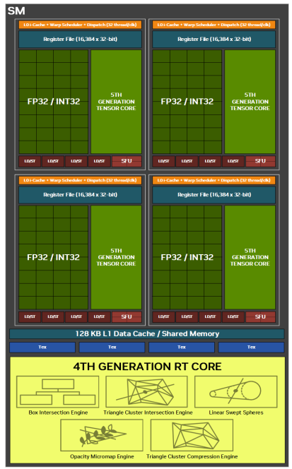

*Figure 2: NVIDIA GB202 sub-partition*

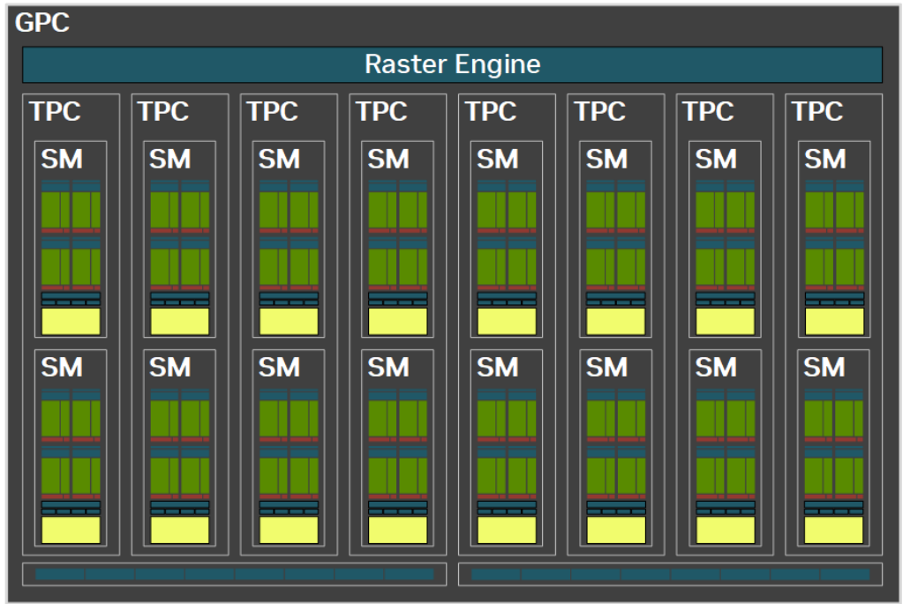

*Figure 3: NVIDIA GB202 GPC*

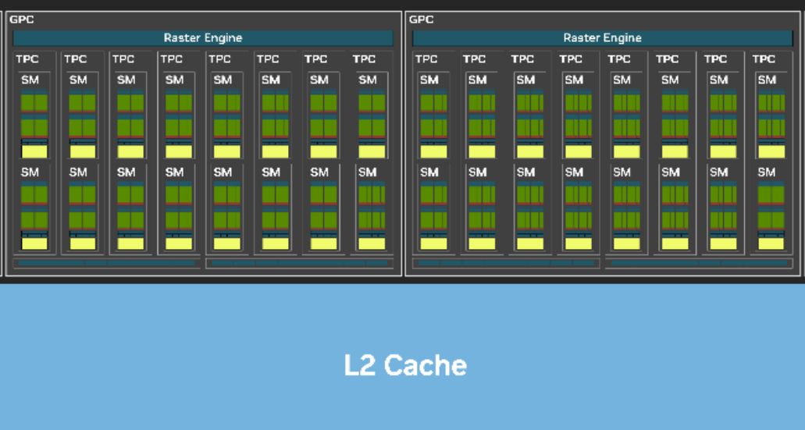

*Figure 4: NVIDIA GB202, a part of the chip*

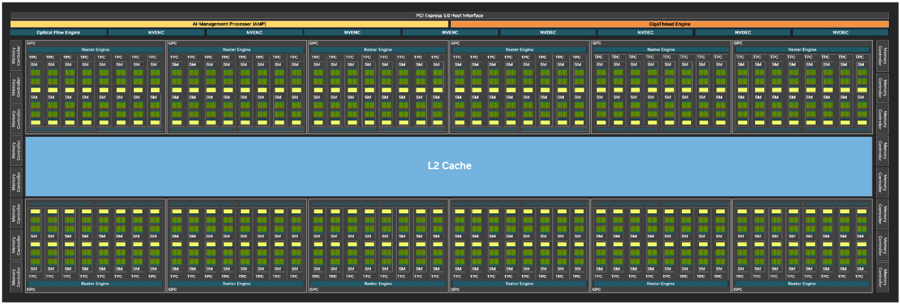

*Figure 5: NVIDIA GB202, the whole chip*


The code below is a simple program for the NVIDIA GB202. Its structure is basically the same as the AMD code seen earlier; the only difference is that the function prefix is cuda.

```cpp
#include <cuda_runtime.h>
#include <stdio.h>

__global__ void vec_add(const float* A, const float* B,
                        float* C, int N)
{
    int i = blockIdx.x * blockDim.x + threadIdx.x;
    if (i < N) C[i] = A[i] + B[i];
}

int main()
{
    const int N = 1024;
    size_t sz = N * sizeof(float);

    // Host allocation and initialization
    float *h_A = new float[N];
    float *h_B = new float[N];
    float *h_C = new float[N];
    for (int i = 0; i < N; i++) { h_A[i] = (float)i; h_B[i] = (float)(N - i); }

    // Device allocation and copy
    float *d_A, *d_B, *d_C;
    cudaMalloc(&d_A, sz);
    cudaMalloc(&d_B, sz);
    cudaMalloc(&d_C, sz);
    cudaMemcpy(d_A, h_A, sz, cudaMemcpyHostToDevice);
    cudaMemcpy(d_B, h_B, sz, cudaMemcpyHostToDevice);

    // Launch kernel: 256 threads per block
    dim3 block(256);
    dim3 grid((N + 255) / 256);
    vec_add<<<grid, block>>>(d_A, d_B, d_C, N);

    // Copy result back and verify
    cudaMemcpy(h_C, d_C, sz, cudaMemcpyDeviceToHost);
    printf("C[0]=%g  C[512]=%g  C[1023]=%g\n", h_C[0], h_C[512], h_C[1023]);
    // Expected: C[i] = i + (1024-i) = 1024 for all i

    cudaFree(d_A); cudaFree(d_B); cudaFree(d_C);
    delete[] h_A; delete[] h_B; delete[] h_C;
    return 0;
}
```

## GPU Matrix Acceleration -- the MI300X as an Example

Similar to the scalar compute module VALU, each SIMD also contains a matrix-operation accelerator. From the hardware point of view, the smallest unit of the accelerator is one outer-product computation. It multiplies two vectors, A x B, where A is a column vector of 4 elements and B is a row vector of 4 elements, so A*B gives a 4x4 matrix, as shown in Figure 6. We call this computation a 4x1x4 outer product.


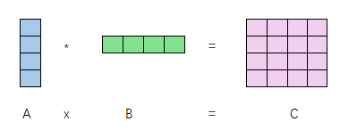

*Figure 6: the smallest unit of matrix acceleration*


The thread discussed in the previous articles corresponds here to one 4x1x4 vector outer-product computation, that is, one thread is responsible for one 4x1x4 outer product. So how do we use this outer-product primitive? Since matrix multiplication is a multiply-accumulate operation, the original matrix multiplication needs a small mathematical transformation. Here we assume that matrix A is 16x4 and B is 4x16.

First, we write the matrix in column-vector form:

$$
\mathbf{ A } = \begin{bmatrix}
    \mathbf a_1 & \mathbf a_2 & \mathbf a_3 & \mathbf a_4
\end{bmatrix}
$$

where $$\mathbf a_i$$ is a 16x1 column vector.

Similarly, for the transpose of matrix B, written in column-vector form:

$$
\mathbf{ B }' = \begin{bmatrix}
    \mathbf b_1 & \mathbf b_2 & \mathbf b_3 & \mathbf b_4
\end{bmatrix}
$$

then matrix B itself can be written as:

$$
\mathbf{ B } = \begin{bmatrix}
    \mathbf b_1' \\
    \mathbf b_2' \\
    \mathbf b_3' \\
    \mathbf b_4'
\end{bmatrix}
$$

where $$\mathbf B'$$ denotes the transpose of B. $$\mathbf b_i$$ denotes a column vector of $$\mathbf B'$$, that is, a row vector of the matrix $$\mathbf B$$ itself.

Then:

$$
\mathbf A \times \mathbf B =
\begin{bmatrix}
    \mathbf a_1 & \mathbf a_2 & \mathbf a_3 & \mathbf a_4
\end{bmatrix}
\times
\begin{bmatrix}
    \mathbf b_1' \\
    \mathbf b_2' \\
    \mathbf b_3' \\
    \mathbf b_4'
\end{bmatrix}
= a_1 \times \mathbf b_1' + a_2 \times \mathbf b_2' + a_3 \times \mathbf b_3' + a_4 \times \mathbf b_4'
\tag{1}
$$

Any term in the formula above, for example $$\mathbf a_3 \times \mathbf b_3'$$, is a 16x1 column vector multiplied by a 1x16 row vector. This is the outer product of two vectors and gives a 16x16 matrix. Adding four such matrices together gives the final result.

Any term in the formula above, for example $$\mathbf a_3 \times \mathbf b_3'$$, can be further partitioned into blocks, which gives an expression that can use the smallest hardware primitive:

For example

$$
\mathbf a_3 = \begin{bmatrix}
    \mathbf a_3^{(0)}  \\
    \mathbf a_3^{(1)} \\
    \mathbf a_3^{(2)}  \\
    \mathbf a_3^{(3)}
\end{bmatrix}
$$

where $$\mathbf a_3^{(1)}$$ is a column vector of 4 elements. Likewise:

$$
\mathbf b_3 = \begin{bmatrix}
    \mathbf b_3^{(0)}  \\
    \mathbf b_3^{(1)} \\
    \mathbf b_3^{(2)}  \\
    \mathbf b_3^{(3)}
\end{bmatrix}
$$

Then:

$$
\mathbf b_3' = \begin{bmatrix}
    \mathbf b_3^{(0)'}  & \mathbf b_3^{(1)'}  & \mathbf b_3^{(2)'}  & \mathbf b_3^{(3)'}
\end{bmatrix}
$$

Finally we obtain:

$$
\mathbf a_3 \times \mathbf b_3' =
\begin{bmatrix}
    a_3^{(0)} \times b_3^{(0)'} & a_3^{(0)} \times b_3^{(1)'} & a_3^{(0)} \times b_3^{(2)'} & a_3^{(0)} \times b_3^{(3)'}  \\
    a_3^{(1)} \times b_3^{(0)'} & a_3^{(1)} \times b_3^{(1)'} & a_3^{(1)} \times b_3^{(2)'} & a_3^{(1)} \times b_3^{(3)'}  \\
    a_3^{(2)} \times b_3^{(0)'} & a_3^{(2)} \times b_3^{(1)'} & a_3^{(2)} \times b_3^{(2)'} & a_3^{(2)} \times b_3^{(3)'}  \\
    a_3^{(3)} \times b_3^{(0)'} & a_3^{(3)} \times b_3^{(1)'} & a_3^{(3)} \times b_3^{(2)'} & a_3^{(3)} \times b_3^{(3)'}
\end{bmatrix}
$$

Each $$a_3^{(i)} \times b_3^{(j)'}$$ is a 4x1 column vector multiplied by a 1x4 row vector, giving a 4x4 matrix. Therefore each $$a_3^{(i)} \times b_3^{(j)'}$$ can be executed by one matrix hardware primitive.

Formula (1) then becomes:

$$
\begin{aligned}
    \mathbf A \times \mathbf B =
    &\begin{bmatrix}
        a_0^{(0)} \times b_0^{(0)'} & a_0^{(0)} \times b_0^{(1)'} & a_0^{(0)} \times b_0^{(2)'} & a_0^{(0)} \times b_0^{(3)'}  \\
        a_0^{(1)} \times b_0^{(0)'} & a_0^{(1)} \times b_0^{(1)'} & a_0^{(1)} \times b_0^{(2)'} & a_0^{(1)} \times b_0^{(3)'}  \\
        a_0^{(2)} \times b_0^{(0)'} & a_0^{(2)} \times b_0^{(1)'} & a_0^{(2)} \times b_0^{(2)'} & a_0^{(2)} \times b_0^{(3)'}  \\
        a_0^{(3)} \times b_0^{(0)'} & a_0^{(3)} \times b_0^{(1)'} & a_0^{(3)} \times b_0^{(2)'} & a_0^{(3)} \times b_0^{(3)'}
    \end{bmatrix} + \\ \\
    & \begin{bmatrix}
        a_1^{(0)} \times b_1^{(0)'} & a_1^{(0)} \times b_1^{(1)'} & a_1^{(0)} \times b_1^{(2)'} & a_1^{(0)} \times b_1^{(3)'}  \\
        a_1^{(1)} \times b_1^{(0)'} & a_1^{(1)} \times b_1^{(1)'} & a_1^{(1)} \times b_1^{(2)'} & a_1^{(1)} \times b_1^{(3)'}  \\
        a_1^{(2)} \times b_1^{(0)'} & a_1^{(2)} \times b_1^{(1)'} & a_1^{(2)} \times b_1^{(2)'} & a_1^{(2)} \times b_1^{(3)'}  \\
        a_1^{(3)} \times b_1^{(0)'} & a_1^{(3)} \times b_1^{(1)'} & a_1^{(3)} \times b_1^{(2)'} & a_1^{(3)} \times b_1^{(3)'}
    \end{bmatrix} + \\ \\
    & \begin{bmatrix}
        a_2^{(0)} \times b_2^{(0)'} & a_2^{(0)} \times b_2^{(1)'} & a_2^{(0)} \times b_2^{(2)'} & a_2^{(0)} \times b_2^{(3)'}  \\
        a_2^{(1)} \times b_2^{(0)'} & a_2^{(1)} \times b_2^{(1)'} & a_2^{(1)} \times b_2^{(2)'} & a_2^{(1)} \times b_2^{(3)'}  \\
        a_2^{(2)} \times b_2^{(0)'} & a_2^{(2)} \times b_2^{(1)'} & a_2^{(2)} \times b_2^{(2)'} & a_2^{(2)} \times b_2^{(3)'}  \\
        a_2^{(3)} \times b_2^{(0)'} & a_2^{(3)} \times b_2^{(1)'} & a_2^{(3)} \times b_2^{(2)'} & a_2^{(3)} \times b_2^{(3)'}
    \end{bmatrix} + \\ \\
    &\begin{bmatrix}
        a_3^{(0)} \times b_3^{(0)'} & a_3^{(0)} \times b_3^{(1)'} & a_3^{(0)} \times b_3^{(2)'} & a_3^{(0)} \times b_3^{(3)'}  \\
        a_3^{(1)} \times b_3^{(0)'} & a_3^{(1)} \times b_3^{(1)'} & a_3^{(1)} \times b_3^{(2)'} & a_3^{(1)} \times b_3^{(3)'}  \\
        a_3^{(2)} \times b_3^{(0)'} & a_3^{(2)} \times b_3^{(1)'} & a_3^{(2)} \times b_3^{(2)'} & a_3^{(2)} \times b_3^{(3)'}  \\
        a_3^{(3)} \times b_3^{(0)'} & a_3^{(3)} \times b_3^{(1)'} & a_3^{(3)} \times b_3^{(2)'} & a_3^{(3)} \times b_3^{(3)'}
    \end{bmatrix}
\end{aligned}
\tag{2}
$$

We can see that there are 4x4x4 = 64 vector outer products in total. Each uses one hardware matrix-multiply primitive and corresponds to one thread, so there are 64 threads in all. Since there are 4 additions above, these 64 threads are divided into 4 groups, with 16 threads per group, which are executed one group after another.

We know that a wavefront on the AMD MI300X is 64 threads, so these 64 threads form exactly one wavefront, and a wavefront is assigned to one SIMD.

A SIMD on the AMD MI300X contains 4 matrix primitives, so 16 cycles are needed to complete the 64 primitive computations above.

### Data input

Each primitive needs 4 + 4 = 8 input values, and these values are reused. However, we can see that the input data differs for every 16 primitive computations: the data used by each group of 16 threads is exactly one column of A and one row of B, 32 values in total. The hardware therefore adopts a convention: each thread within a group of 16 threads is responsible for loading one element of matrix A and one element of matrix B. The exact correspondence is shown in Figure 7. The thread numbers run from 0 to 63; the numbers in Figure 7 are the thread numbers, and each small box in the figure corresponds to one element of the matrix.

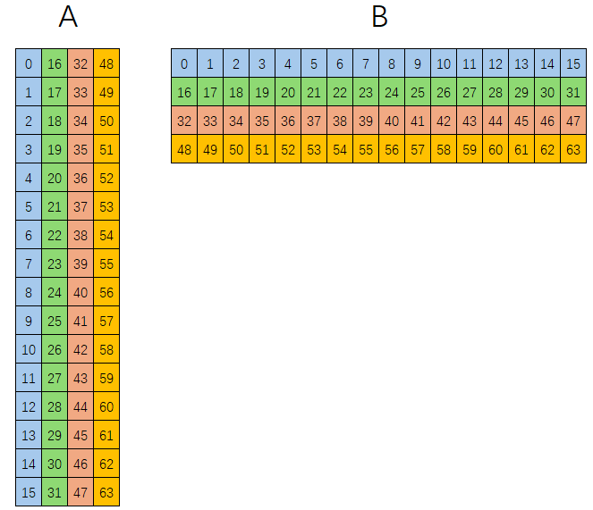

*Figure 7: input data for the 64 threads*

Let us look at the code:


```cpp
#define M 16
#define N 16
#define K 4
__global__ void sgemm_16x16x4(
    const float *A, const float *B, float *D)
{
    // 1. Recover 2D coordinates from the linear ID 0~63
    int tid = threadIdx.x; // the block is (64, 1, 1) here, so only x is used
    int x = tid % 16;
    int y = tid / 16;

    using float4 =
        __attribute__( (__vector_size__(K * sizeof(float)) )) float;
    float4 dmn = {0};

    // 2. Compute the indices from the coordinates
    int mk = y + K * x;
    int kn = x + N * y;

    float amk = A[mk];
    float bkn = B[kn];

    dmn = __builtin_amdgcn_mfma_f32_16x16x4f32(amk, bkn, dmn, 0, 0, 0);

    // 3. Write back using the coordinates
    for (int i = 0; i < 4; ++i) {
        const int idx = x + i * N + y * 4 * N;
        D[idx] = dmn[i];
    }
}


int main() {

    .....

    dim3 block(64,1,1);
    dim3 grid(1,1,1);

    // Execution configuration call
    sgemm_16x16x4<<<grid, block>>>(d_A, d_B, d_D);

    .....

    return 0;
}
```

In the code, the thread ID (tid) that each thread receives is used, through tid/16 and tid\%16, to compute the corresponding row and column coordinates. Since the row and column coordinates are exactly swapped between A and B, the indices of the input data are computed as:

Index into matrix A: int mk = y + K * x;

Index into matrix B: int kn = x + N * y;


### Data output

The previous code already showed the output operation; here we explain it in detail. The design idea of the AMD MI300X is that a thread is responsible for outputting a 4x1 vector. The result matrix has 16x16 = 256 elements, and as discussed above we have 64 threads, so each thread is responsible for outputting 4 elements, as shown in Figure 8:

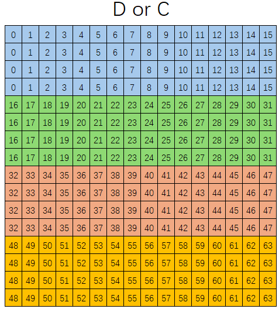

*Figure 8: output for the 64 threads*

We can see from the figure that the mapping is similar to that of matrix B, except that each thread outputs 4 elements in the vertical direction:
```cpp
#define M 16
#define N 16
#define K 4
__global__ void sgemm_16x16x4(
    const float *A, const float *B, float *D)
{
    // 1. Recover 2D coordinates from the linear ID 0~63
    int tid = threadIdx.x; // the block is (64, 1, 1) here, so only x is used
    int x = tid % 16;
    int y = tid / 16;

    ......

    dmn = __builtin_amdgcn_mfma_f32_16x16x4f32(amk, bkn, dmn, 0, 0, 0);

    // 3. Write back using the coordinates
    for (int i = 0; i < 4; ++i) {
        const int idx = x + i * N + y * 4 * N;
        D[idx] = dmn[i];
    }
}
```

y * 4 * N tells which colored region we are in, that is, which group of 16 threads.

x is the index of the thread within the same colored region.

i * N is the row within the same colored region.

Then idx = x + i * N + y * 4 * N is the index in memory.

### Accumulating with matrix C

If what we want to compute is D = A * B + C, then

```cpp
__global__ void sgemm_16x16x4(const float *A, const float *B, const float *C, float *D){
    // 1. Flatten the 3D thread block into a 1D linear ID (0~63)
    int tid = threadIdx.x + threadIdx.y * blockDim.x +
              threadIdx.z * blockDim.x * blockDim.y;

    // Map linear ID to MFMA-specific 2D coordinates
    int x = tid % 16;      // 0~15
    int y = tid / 16;      // 0~3

    using float4 = __attribute__( (__vector_size__(4 * sizeof(float)) )) float;
    float4 dmn;

    // 2. Determine the index for C and load it into the accumulator (dmn)
    // Since C shares the same layout as D, the index
    // calculation is exactly the same.
    for (int i = 0; i < 4; ++i) {
        const int c_idx = x + i * 16 + y * 4 * 16; // N = 16
        dmn[i] = C[c_idx];
    }

    // 3. Calculate indices for A and B
    int mk = y + 4 * x;   // K = 4
    int kn = x + 16 * y;  // N = 16

    float amk = A[mk];
    float bkn = B[kn];

    // 4. MFMA instruction now computes: dmn = amk * bkn + dmn (which holds C)
    dmn = __builtin_amdgcn_mfma_f32_16x16x4f32(amk, bkn, dmn, 0, 0, 0);

    // 5. Write back the final result to D
    for (int i = 0; i < 4; ++i) {
        const int d_idx = x + i * 16 + y * 4 * 16;
        D[d_idx] = dmn[i];
    }
}
```

The correspondence between the elements of C and the threads is the same as for D. C is first read into dmn and passed into the function as an argument, and the matrix accelerator performs the accumulation automatically.

### Internal accumulation

During the internal computation, the result computed by each group of 16 threads is accumulated with the result computed by the next group of 16 threads, that is, the additions in formula (2).

Formula (2) can be written as:

$$
\mathbf A \times \mathbf B =
\sum_{k=0}^3 \left \{
\begin{bmatrix}
    a_k^{(0)} \times b_k^{(0)'} & a_k^{(0)} \times b_k^{(1)'} & a_k^{(0)} \times b_k^{(2)'} & a_k^{(0)} \times b_k^{(3)'}  \\
    a_k^{(1)} \times b_k^{(0)'} & a_k^{(1)} \times b_k^{(1)'} & a_k^{(1)} \times b_k^{(2)'} & a_k^{(1)} \times b_k^{(3)'}  \\
    a_k^{(2)} \times b_k^{(0)'} & a_k^{(2)} \times b_k^{(1)'} & a_k^{(2)} \times b_k^{(2)'} & a_k^{(2)} \times b_k^{(3)'}  \\
    a_k^{(3)} \times b_k^{(0)'} & a_k^{(3)} \times b_k^{(1)'} & a_k^{(3)} \times b_k^{(2)'} & a_k^{(3)} \times b_k^{(3)'}
\end{bmatrix}
\right \}
$$

Each group of 16 threads computes the matrix inside the summation and accumulates it with the previously computed result; this is done automatically by the hardware.

### V\_MFMA\_F32\_16x16x1F32

This function (a compiler built-in primitive) multiplies a 16x1 column vector by a 1x16 row vector to obtain a 16x16 matrix.

From the point of view of the input it is the same as the previous example. However, a wavefront has 64 threads while multiplying a 16x1 column vector by a 1x16 row vector needs only 16 threads, so within one wavefront four such "16x1 column vector times 1x16 row vector" products can be performed.

Only the correspondence between the threads and the accumulation matrix C and the output matrix D needs special attention here.


Each thread is responsible for one 4x1 vector in each of the four 16x16 matrices, as shown in Figure 9.

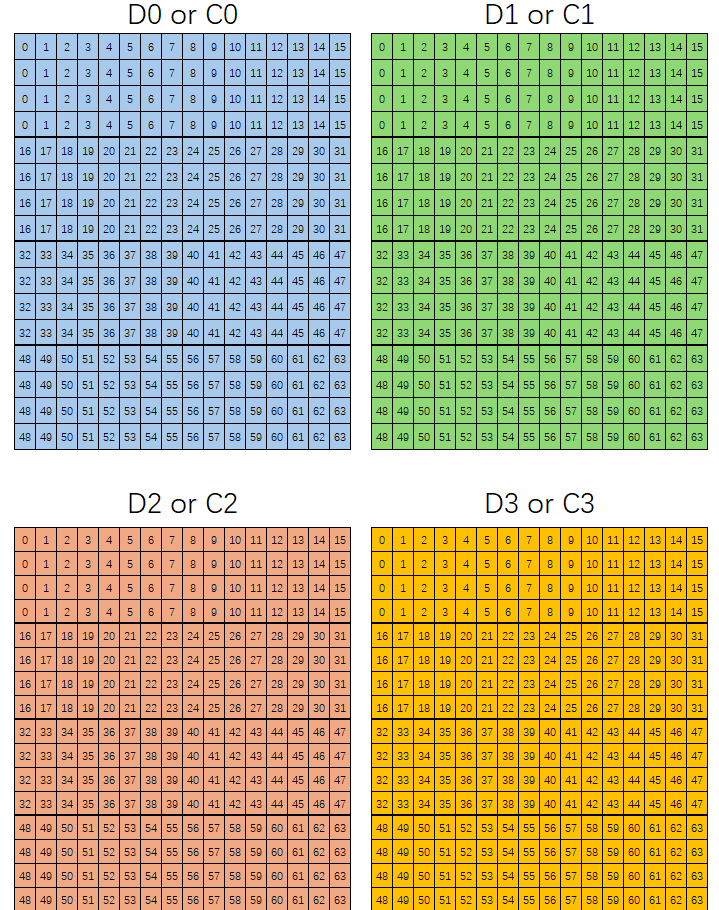

*Figure 9: C/D matrix mapping for the 16x16x1 case*

### Two-dimensional block definition

If a block is defined as two-dimensional threads, then:

tid = threadIdx.x + threadIdx.y * blockDim.x

That is, threadIdx.x corresponds to the column of matrix B, and threadIdx.y corresponds to the row of matrix B.


```cpp
#define M 16
#define N 16
#define K 4


__global__ void sgemm_16x16x4(const float *A, const float *B, float *D)
{
    using float4 = __attribute__( (__vector_size__(K * sizeof(float)) )) float;
    float4 dmn = {0};

    int mk = threadIdx.y + K * threadIdx.x;
    int kn = threadIdx.x + N * threadIdx.y;

    float amk = A[mk];
    float bkn = B[kn];
    dmn = __builtin_amdgcn_mfma_f32_16x16x4f32(amk, bkn, dmn, 0, 0, 0);

    for (int i = 0; i < 4; ++i) {
        const int idx = threadIdx.x + i * N + threadIdx.y * 4 * N;
        D[idx] = dmn[i];
    }
}


dim3 grid (1, 1, 1);
dim3 block(16, 4, 1);

sgemm_16x16x4 <<< grid, block >>> (d_A, d_B, d_D);
```

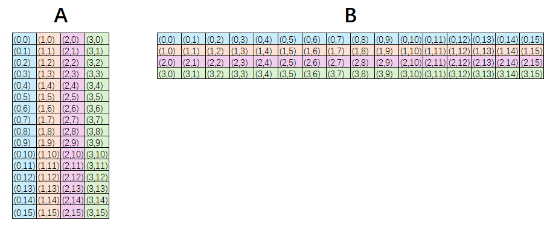

*Figure 10: Enter Caption*

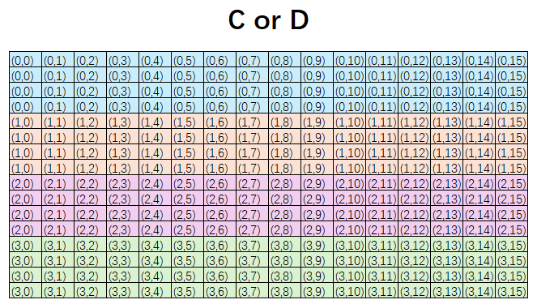

*Figure 10: Enter Caption*
